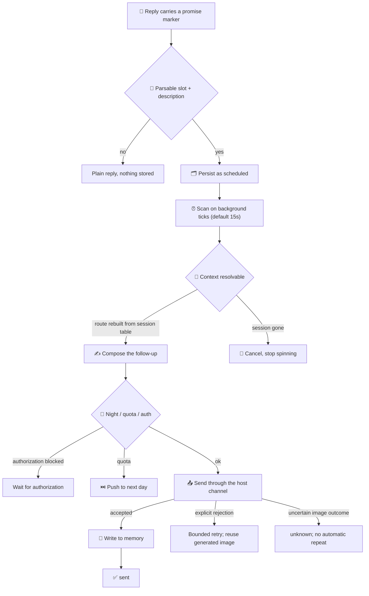

# livingEmotion 🎯

[简体中文](README.md) · **English**

**🧠 Mood · 🌙 Sleep · 🤝 Relationships · 📓 Diary & Dreams · 💭 Promises · 🎛️ Console**

LivingEmotion gives your AstrBot character a mood that keeps drifting, relationships
that accumulate, a sleep schedule, and a console to watch it all. Everything runs
inside the plugin; it reuses the persona you already configured in AstrBot.

> First run: keep the model-driven features off and start with rule-based mood.
> See [installation](docs/installation.md) for the full setup.

## ✨ What it does

| You want | What LivingEmotion does |
| --- | --- |
| 🧬 Keep your persona | Follows the native persona of the session; no built-in character |
| 🧠 Mood that moves | Pleasure / arousal / stress / social need, clamped, decaying over time; five-axis radar adds a model-written "poise" |
| 👂 Understand the user | "I'm sad" is an observation about them, not an override of the bot's mood |
| 🤝 Explainable relationships | V2 scores only current actions clearly directed at the bot; automatic changes of 0.5–1 points, manual 0.1-point editing |
| 🌙 Sleep and energy | Awake / dozing / groggy / sleepy / deep sleep; reply budget, wake countdown, 24h curve |
| 💬 Proactive chatting | Random waits, memory callbacks, relationship-driven topics; off by default |
| 💭 Promises kept | "I'll send it later" becomes a real task that fires on time, even after a restart |
| 📓 Diary and dreams | First-person diary with weather; dreams reviewed separately |
| 🎛️ Own console | Nine sections, scope filtering, two themes, no external CDN |

## 🆕 What's new in 0.4.1

- Content-rejected photos, selfies and drawings ask what to change or whether to cancel.
  A repeated rejection explains that the revised idea also failed and offers the choice again.
- Only a concrete new description resumes the original image; “OK” or “try again” does not.
  Unknown generation or delivery outcomes still require verification.
- Existing waiting images gain persistent notice tracking automatically. Upgrade LivingHello
  to **2.7.8** for the complete handoff. [Behavior and migration (Chinese)](docs/promise-adjustment-20261118.md).

### Retained from 0.4.0

- Rolling 300-second joy budget: event-driven rises are limited to 5 percentage
  points and falls to 10, with independent budgets. Neutral or unclear interactions
  do not raise joy; time decay and weather adjustments are separate.
- Relationship scoring V2 keeps ordinary chat, quotations and unclear targets at
  zero; clear praise/corrections add 0.5 points, substantial care/help adds 1.
  Existing scores, freezes and administrator-only 100-point relationships remain.
- Five configurable personal-image refusal rates: 90/60/30/10/5% by relationship
  stage. Existing promised tasks remain eligible for delivery.
- Flat sleep/energy settings control daytime recovery and recovery-sleep deadlines.
  Existing explicit configuration values stay effective after upgrade.
- Deferred images persist generation/delivery checkpoints and use LivingHello's
  delivery contract. Promise tasks and host `future_task` jobs coordinate ownership;
  uncertain paid requests or delivery outcomes are not automatically repeated.

See the [changelog](CHANGELOG.md) for compatibility and validation boundaries.

## 💭 Promises

The bot appends an invisible marker (`<!--promise:slot:description-->`) to a reply.
The plugin strips it before sending, stores the task, and delivers on schedule.

Stored contexts rebuild the exact host route after restart. Delivery still needs
current authorization and quota; `sent` means host acceptance, not final platform
delivery. Deferred images use LivingHello's public contract and persistent receipts.
Immediate requests are handled in the current turn; only explicitly delayed
commitments become tasks. Delivered follow-ups can be recalled from memory.

Slots: 马上 (2–5 min), 一会儿 (15–30 min), 待会 (40–70 min), 今晚 (20:00–22:59),
明天 / 过几天. Up to 3 active per session; identical wording merges.

Cancel by saying "never mind" / "cancel" — with a single task it just cancels,
with several it asks which one. Full details in [docs/promise.md](docs/promise.md).

## 🚀 Quick start

1. Install via [docs/installation.md](docs/installation.md). Requires AstrBot 4.29.1–4.29.4, Python 3.12+.
2. Open the plugin page `livingemotion` → **Settings → Quick start**.
3. Pick a persona (follow the session, or pin one).
4. Keep mood intensity at **normal**. Set a timezone if you want the sleep schedule.
5. Save, then look at the **TA** page. Empty state before the first real chat is normal.

## 🗺️ Docs

- [Plugin manual](docs/plugin-manual.md)
- [Promise tasks](docs/promise.md)
- [Five-dimension emotion](docs/emotion-five-dimension.md)
- [Joy window](docs/joy-window.md) · [Relationship scoring V2](docs/relationship-scoring-v2.md)
- [Image refusal rates](docs/relationship-image-refusal.md) · [Sleep and energy](docs/sleep-energy-rules.md)
- [Deferred image tasks](docs/promise-actions-20261116.md) · [Cooperation contract](docs/cooperation-contract-20261116.md)
- [Architecture](docs/architecture.md) · [API](docs/api.md)
- [Compatibility](docs/compatibility.md) · [Memory](docs/memory.md)
- [Changelog](CHANGELOG.md)

## 🔐 Memory and privacy

Read and write are separate switches. Without LivingMemory the plugin uses a local
vector store (10,000 records / 30 days by default). With LivingMemory it only uses
public facades and real events; no fallback to private databases.

Promise delivery is the exception: the message has already been sent, this is a
post-hoc archive entry, so the source may be rebuilt from the session table.

## 🧯 Failure boundaries

`queued` means queued. `accepted` means the local transaction committed.
Neither means delivered. `send_message(False)` is recorded as rejected, anything
else as unknown. Unknown is never auto-resent.

## 📦 Changelog

Current version **0.4.1** — natural adjustment questions, persistent notice deduplication,
and user-controlled resumption or cancellation of content-rejected images.
See [CHANGELOG.md](CHANGELOG.md).

MIT for original content. See [LICENSE](LICENSE) and [THIRD_PARTY_NOTICES.md](THIRD_PARTY_NOTICES.md).

**🎯 Mood first, then the words feel real.**
