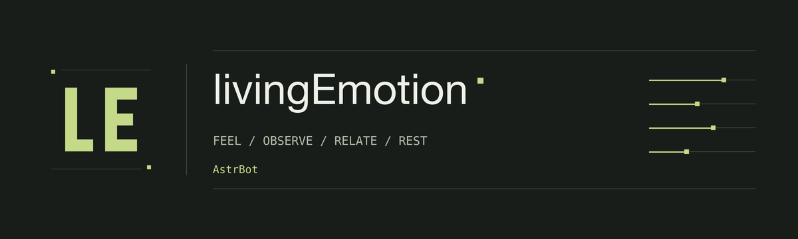

# livingEmotion

[简体中文](README.md) · **English**

Persistent mood, relationships, sleep and energy for AstrBot personas, with an automatically refreshed console.
Optional proactive chat, journals, dreams, memory and delayed promises use separate permissions.

Install on AstrBot 4.29.1–4.29.4 with Python 3.12 or later. Open `livingemotion → Settings`,
select your persona mode and save. Local mood rules work without model calls.
Configure an IANA timezone before enabling sleep. Disabling sleep keeps the persona awake at 100% energy.

Delayed promises execute when due. Image tasks can bind and settle the original promise through LivingHello 2.9.0.
Known image failures may receive bounded wording repairs; unknown generation or delivery waits for verification.
Successful wording substitutions are scoped by the actual image provider, model and protocol.
`sent` records acceptance by the sending interface, not user read confirmation.

| Documentation | Contents |
| --- | --- |
| [User guide](docs/user-guide.md) | Controls, daily operations and simulation boundaries |
| [Configuration reference](docs/config-reference.md) | Every field, default, location, effect and example |
| [Technical guide](docs/technical-guide.md) | Decision flows, persistence, integration and upgrades |
| [Image prompt contract](docs/image-prompt-retry.md) | Bounded repairs and mapping reuse |
| [Troubleshooting](docs/troubleshooting.md) | Configuration conflicts, generation and delivery |
| [Documentation index](docs/README.md) | Current reference and development documents |
| [Changelog](CHANGELOG.md) | Historical changes |

Model generation can incur provider charges. Normal use needs neither Node nor an external CDN.
Developer: [AKIhunter](https://github.com/AKIhunter). Feedback QQ group: 991350637.
