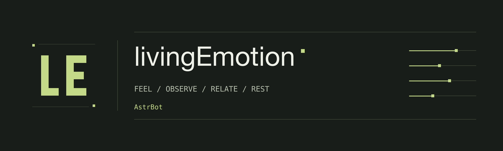
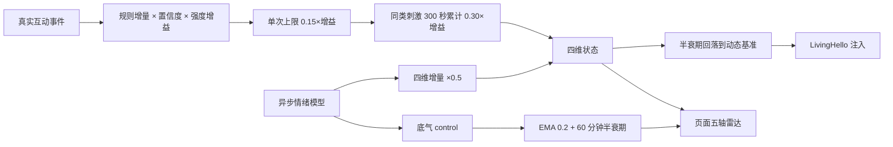

# livingEmotion



开发者：[AKIhunter](https://github.com/AKIhunter)。这是 AstrBot 的 LivingEmotion 插件手册入口；
完整使用说明与运行流程见 [插件帮助手册](docs/plugin-manual.md)。

基于 AstrBot 原生人格的生活状态控制台，区分 **Bot 感受**、
**对方情绪观察**、**关系证据**和**作息精力**。记忆可接入 LivingMemory 或使用本地向量库，
核心功能不依赖从绫或 Bot Manager。
这是可解释的角色状态系统，不宣称模型具有真实主观意识。

> 当前改版采用柔和的复古未来主义：原子轨道、磁带设备与航天仪表，搭配奶白、奶咖和淡绿。
> 新规则与上手步骤见 [TA 的生活控制台](docs/life-console.md)，支持范围见
> [兼容矩阵](docs/compatibility.md)。旧版本测试数字保留在历史报告，不作为改版验收。
> 目标仓库 [AKIhunter/astrbot_plugin_livingemotion](https://github.com/AKIhunter/astrbot_plugin_livingemotion)
> 必须 **PRIVATE**，通过正常认证访问；实际提交与 CI 结果以仓库记录为准。
> 本地验收不代表远端 CI 或生产部署。

## 能做什么

| 你希望 | 行为与边界 |
| --- | --- |
| 沿用原来的人设 | 默认跟随当前会话原生人格，也可显式选择或关闭；不带固定“绫”人设 |
| 感受持续变化 | 愉悦、唤醒、压力、社交需求按规则限幅并随时间恢复；页面五轴雷达另显示模型写回的「底气」；情绪强度三档可调 |
| 理解对方 | “我很难过”是对方观察，不直接覆盖 Bot 心情 |
| 关系可解释 | 以人格为中心的二维力图、平台账号搜索、好感0–100/步进0.1手动修改；缺失维度不猜测 |
| 长夜与精力 | 清醒、小憩、恍惚、困、沉睡；回复轮数、唤醒倒计时、24小时曲线和事件日志 |
| 自然地主动聊天 | 随机等待、记忆回访、近况关心和关系/情绪驱动；话题避重、未回应退避，实际发送默认关闭 |
| 私人日记与梦 | Bot 第一人称日记附日期、住所天气；日记与梦境分开查看，正文遵守来源权限 |
| 自选记忆 | LivingMemory 开关、本地原生向量 Provider；读写分别启用，删除与换模型有代际隔离 |
| 独立管理 | 九区、全局/私聊/群聊筛选、集中设置、圆形扩散双主题，无外部 CDN |

不包含从绫工具箱或 QQ 扩展，不自动复制其他插件数据库。
本地验收只覆盖报告列出的范围；动态能力不等于已获发送许可。
独立安装默认 `active`，不会修改现有部署或消费者配置；自主、群主动、日记、梦与外部写入须分别启用。

## 第一次使用

1. 按[安装说明](docs/installation.md)加载插件，使用 Python >=3.12 和 metadata 允许的宿主版本。
2. 从 AstrBot 插件页面打开 `livingemotion`，进入“设置 → 快速开始”。
3. 选择原生人格、时区与作息。规则情绪不需要模型；启用作息前核对沉睡、起床与赖床区间。
4. 按需选择日记/梦境/补课/晚安模型，填写住所；记忆可选择 LivingMemory 或本地向量 Provider。
5. 保存一次，按人格和全局/私聊/群聊范围查看 TA、关系与长夜。
   空库显示空态；页面模拟不调用模型、不发送消息。

### 默认开关

| 配置 | 默认 | 说明 |
| --- | --- | --- |
| `enabled` / `mode` | `true` / `active` | `observe_only` 观察但不注入或自主发送 |
| `emotion_model_enabled` | `false` | 普通规则状态不需要 Provider |
| `autonomy_enabled` / `group_autonomy_enabled` | 均 `false` | 还须有效时区、完整范围白名单、路由和硬闸门 |
| `diary_enabled` / `dream_enabled` | 均 `false` | 有权素材与受支持 Provider；梦另须实时 REM |
| `livingmemory_enabled` / `memory_read` / `memory_write` | 均 `false` | 默认本地向量接口；不自动读取或收录 |
| `night_policy_version` / `persona_shared_state` | 新安装 `2` / `true` | 旧配置缺失字段保留 `1` / `false`，升级后可手动切换 |
| `night_enabled` / `night_schedule_enabled` | `true` / `false` | 计划作息需有效时区；`allow_sleep` 控制真正入睡 |
| `closing_enabled` / `closing_random` | 均 `false` | 独立于闲置主动；随机关闭使用本地文案 |

配置定义以 [`config.py`](config.py) 和 [`_conf_schema.json`](_conf_schema.json) 为准；
页面使用同一个原生配置对象，保存带版本和原因，409 后刷新复核，不自动重试。

## 情绪怎么算

运行期只算四维，页面展示五维；「底气」只由异步情绪模型写、只用于展示，
不参与本地规则、衰减基准和回复注入。详细口径见
[五维情绪：计算、展示与强度档位](docs/emotion-five-dimension.md)。



| 情绪强度 | 配置值 | 增益 | 单次上限 | 同类累计上限 |
| --- | --- | --- | --- | --- |
| 保守 | `gentle` | 1.35 | 0.2025 | 0.405 |
| 平常（推荐） | `normal` | 1.60 | 0.2400 | 0.480 |
| 激进 | `intense` | 2.00 | 0.3000 | 0.600 |

三档只放大增量与两道闸门，不改半衰期和衰减速度。
配置位置：AstrBot 管理面板 → 插件 → livingEmotion → 配置 → 情绪 → 情绪强度；
保存后重启 AstrBot 生效。旧配置与旧状态无需迁移。

「兴奋」按唤醒超出基线的部分计算：默认扣除 0.3，已细化的状态扣除动态基准。
阴天加成不再把平常唤醒误判成兴奋；标签、曲线和梦境采用同一个 `surprise` 公式。
具体计算与限制见 [标签计算流程](docs/emotion-five-dimension.md#页面标签与兴奋口径)。

## 导航

- [AstrBot 插件帮助手册与完整流程图](docs/plugin-manual.md)
- [页面、作息、关系、记忆与快速开始](docs/life-console.md)
- [五维情绪：计算、展示与强度档位](docs/emotion-five-dimension.md)
- [随机主动聊天、选题与节奏配置](docs/proactive-life.md)
- [安装与原生配置](docs/installation.md)
- [架构与状态计算](docs/architecture.md)
- [进程内 API 和管理接口](docs/api.md)
- [兼容矩阵与证据边界](docs/compatibility.md)
- [记忆来源与授权](docs/memory.md)
- [迁移 CLI 与回退](docs/migration.md)
- [交付状态、CI 分层与历史证据](docs/delivery-notes.md)

以上为当前用户入口；`FOUNDATION`、`CONTRACTS`、`DOMAIN`、`INTEGRATION`、
各模块交接及 `verification-*` 保存阶段契约或证据，不作为另一份当前安装指南。
证据数量不可相加，也不能用旧通过覆盖新失败。

## 记忆与隐私

长期记忆读取和本地自动写入分别控制。关闭 LivingMemory 接入时使用本地向量接口，
默认最多10000条、30天；缺向量模型或超时返回空。旧显式 local_lite 记录保持只读与原期限。
切换模型不跨维度查询、不延长正文寿命，删除/清空阻止迟到请求写回。

开启 LivingMemory 接入时仅使用公开门面与真实事件，授权不可用返回空，不回退私有库。
后台没有真实事件时不伪造身份；日记与补课可使用自身授权归档。
状态共享不合并私聊/群聊正文，私聊情绪解释不会注入群聊。

## 兼容性与页面

页面有九个分区，记录每页10条，白昼/黑夜切换不改业务状态。
宿主 iframe 禁止 localStorage 时主题仅本次有效，刷新回系统主题。
认证失效清空私人视图；页面资源 token 不是管理凭据。

模型使用 AstrBot 原生 **`ProviderOpenAIOfficial` 的纯文本 Chat Completions 路径**；
Qwen 纯文本参数由原生 Provider + 合成 transport 验证，未请求生产模型。
输入以完整 UTF-8 字节数加 256 模板余量作保守上界，不是精确 token usage；
不需要 `tiktoken`。其他 Provider 未验证并拒绝生成。
默认共享并发 1、队列 100、每日 48 次，输入/输出预算 4096/1024、超时 30 秒；
不发送 tools 或图片，Qwen 关闭 thinking，服务可采用更严格上限。
向量接口另支持 AstrBot 原生 DashScope/OpenAI 提供者，复用宿主配置。

## 失败边界

`queued` 只表示排队，事件 `accepted` 只表示本地事务提交，不代表生成或投递成功。
AstrBot `send_message` 的 False 被记为 rejected，其余返回值（包括 True）为 unknown。
unknown 不自动重发、不退款、不产生成功行为证据。原生 after-sent 不能作为送达确认。
新版唤醒窗口以第一次回复提交到宿主输出流程起算，分段、图片与TTS不重复计轮或扣精力。
旧规则1保留既有120秒收尾限制；新规则2不以平台回执代替绝对作息时间。

生成后仍复核人格、身份、受众、路由、清除代际及新的人类消息。
普通聊天在受测补充状态读取故障时继续，自主执行保守停止；
活动状态下原生回复先缓冲，在输出前复核睡眠与来源；任何最终校验失败停止该结果。
历史性能结果不是本版容量承诺，本地验收不代表生产部署。

## 常见问题

**关闭记忆为何还有记录？** 长期记忆开关不删除状态、关系、短期归档和额度。

**关闭睡眠后为何仍疲劳？** 该开关控制是否真正入睡和阻断聊天，精力仍按规则记录。

**开关已开为何拒绝生成？** 还须满足 Provider、时区、素材、授权、预算及旧迁移约束；
以具体原因码为准，不通过重复点击绕过。

**为什么阴天也会显示兴奋？** 旧公式把平常唤醒计入惊讶，叠加天气后容易越过标签阈值；
现已改为只算超出基线的部分。实际唤醒高于基线时仍可能显示兴奋，见
[计算说明](docs/emotion-five-dimension.md#页面标签与兴奋口径)。

**能直接复制从绫数据库吗？** 不能。使用[迁移 CLI](docs/migration.md)预览一致快照并选择导入，
不恢复旧 pending，也不能忽略 WAL。

## 使用指令与开发

已注册 `le_wake`，仅已认证管理员可手动叫醒；实际前缀以宿主配置为准。
没有 `/livingemotion ...` 命令族。受信插件通过 `plugin.api` v1 门面协作，
不能将 Python 参数 `admin=true` 当作管理身份，详见 [API](docs/api.md)。

从插件根目录检查：

```bash
python3.12 -m venv .venv-ci
.venv-ci/bin/python -m pip install -r requirements-dev.txt
.venv-ci/bin/python -m pytest -q
npm ci --prefix tests/ui --ignore-scripts --no-audit --no-fund
npm --prefix tests/ui run build
npm --prefix tests/ui test
tests/ui/node_modules/.bin/playwright install chromium
npm --prefix tests/ui run test:browser
```

普通 pytest 只运行可移植层；真实宿主、console ASGI 和原生 Provider payload
须[显式运行](docs/delivery-notes.md#检查分层)，不通过 skip 冒充通过。
浏览器命令会更新合成证据，不应覆盖其他验收者正在使用的产物。

## 更新日志与来源

版本与更新见 [metadata.yaml](metadata.yaml)、[CHANGELOG.md](CHANGELOG.md)。
这是参考从绫行为需求的**非官方独立实现/衍生项目**，不声称上游背书或授权发行。
补课迁入固定上界、完整分块与回执流程语义，不复制上游私有SQL、人设或素材；
MIT 仅适用于本项目权属明确的新写内容。
见 [LICENSE](LICENSE)、[来源说明](THIRD_PARTY_NOTICES.md)。
Logo/Banner 为原创几何 LE 与 livingEmotion 字标，仅参考极简留白、细线和黄绿配色，
不使用莱茵生命官方图案或上游素材。本次不包含商店上架或生产部署。
BiliBot/LivingHello 的消费者本地改动不进入新插件仓库提交；现有部署保持不变。
