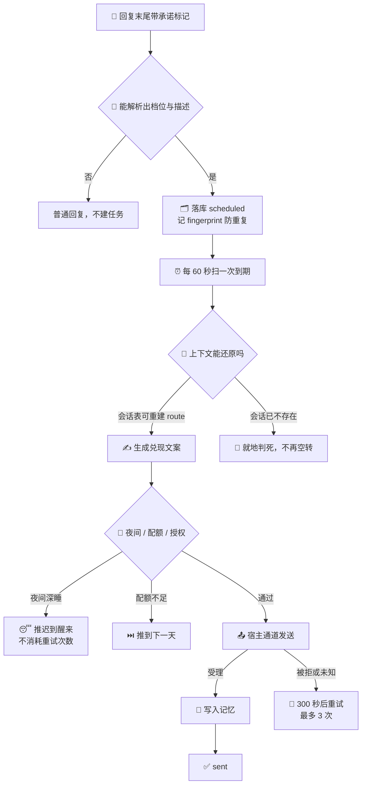
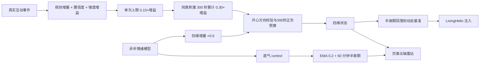

# livingEmotion 🎯


[](https://docs.astrbot.app/)
[](CHANGELOG.md)

**简体中文** · [English](README.en.md)

**🧠 情绪 · 🌙 作息 · 🤝 关系 · 📓 日记梦 · 💭 承诺 · 🎛️ 控制台**

[🚀 第一次使用](#-第一次使用) · [💭 承诺任务](#-承诺任务) · [🧮 情绪怎么算](#-情绪怎么算) · [❓ 常见问题](#-常见问题)

开发者：[AKIhunter](https://github.com/AKIhunter)。这是 AstrBot 的 LivingEmotion 插件手册入口；
完整使用说明与运行流程见 [插件帮助手册](docs/plugin-manual.md)。有问题可以加入qq群聊反馈：991350637

LivingEmotion 给你的 AstrBot 角色增加持续变化的心情、人物关系、作息和精力。
你可以在页面上看状态，再按需开启主动聊天、日记、梦境、记忆和承诺兑现。
它沿用 AstrBot 中已经设置的人格，核心功能由插件自身实现。
页面里的情绪是软件计算的角色状态，不代表模型真的有人的感受。

> 第一次用：先按下面五步配置，保留“情绪模型、主动聊天、自动日记和梦境”关闭，
> 体验本地规则情绪。准备使用模型生成时，再配置模型并开启对应功能。
> 仓库目前公开，可以直接查看或下载源码，详见 [安装说明](docs/installation.md)。

## ✨ 能做什么

| 你希望 | LivingEmotion 怎么做 |
| --- | --- |
| 🧬 沿用原来的人设 | 默认跟随当前会话原生人格，也可显式选择或关闭；不带固定“绫”人设 |
| 🧠 感受持续变化 | 愉悦、唤醒、压力、社交需求按规则限幅并随时间恢复；页面五轴雷达另显示模型写回的「底气」；情绪强度三档可调 |
| 👂 理解对方 | “我很难过”是对方观察，不直接覆盖 Bot 心情 |
| 🤝 关系可解释 | 好感 V2 按明确对象的当前言行自动增减 0.5–1 分；二维力图、账号搜索与 0.1 步进人工校正 |
| 🌙 长夜与精力 | 清醒、小憩、恍惚、困、沉睡；回复轮数、唤醒倒计时、24 小时曲线和事件日志 |
| 💬 自然地主动聊天 | 随机等待、记忆回访、近况关心和关系/情绪驱动；话题避重、未回应退避，实际发送默认关闭 |
| 💭 **说了就记得做** | 回复里那句“一会儿发你”会被记成待办，到点自己兑现，不用你再催 |
| 📓 私人日记与梦 | Bot 第一人称日记附日期、住所天气；日记与梦境分开查看，正文遵守来源权限 |
| 🧷 自选记忆 | LivingMemory 开关、本地原生向量 Provider；读写分别启用，删除与换模型有代际隔离 |
| 🎛️ 独立管理 | 九区、全局/私聊/群聊筛选、集中设置、圆形扩散双主题，无外部 CDN |

不包含其他插件的工具箱或 QQ 扩展，不导入其他插件数据库。
本地验收只覆盖报告列出的范围；动态能力不等于已获发送许可。
独立安装默认 `active`，不会修改现有部署或消费者配置；自主、群主动、日记、梦与外部写入须分别启用。

## 🚀 第一次使用

1. 按[安装说明](docs/installation.md)获取并加载插件。当前支持 AstrBot 4.29.1–4.29.4、Python 3.12 及以上。
2. 打开插件页面 `livingemotion`，进入“设置 → 快速开始”。
3. 选择人格。跟随模式用当前聊天的人格；固定角色需选择“指定人格”，再选择下方的人格。
4. 情绪强度先选“平常”。如要使用作息，填写时区（中国大陆填 `Asia/Shanghai`），
   核对睡眠与起床时间；保存时区或作息会启用时间表，“允许 TA 睡眠”决定是否因睡眠阻断聊天。
5. 在插件自己的设置页保存，返回 TA 查看状态。新安装没有聊天记录时显示空白或“未采集”正常；
   在已有聊天里正常互动后，页面会自动刷新状态。

想开启更多功能、确认配置生效或排查报错，直接看 [新手插件手册](docs/plugin-manual.md)。

### 🎛️ 默认开关

| 配置 | 默认 | 说明 |
| --- | --- | --- |
| `enabled` / `mode` | `true` / `active` | `observe_only` 观察但不注入或自主发送 |
| `emotion_model_enabled` | `false` | 普通规则状态不需要 Provider |
| `autonomy_enabled` / `group_autonomy_enabled` | 均 `false` | 还须有效时区、完整范围白名单、路由和硬闸门 |
| `promise_enabled` | `true` | 承诺识别与兑现；关闭后既不新建也不兑现 |
| `diary_enabled` / `dream_enabled` | 均 `false` | 有权素材与受支持 Provider；梦另须实时 REM |
| `livingmemory_enabled` / `memory_read` / `memory_write` | 均 `false` | 默认本地向量接口；不自动读取或收录 |
| `night_policy_version` / `persona_shared_state` | 新安装 `2` / `true` | 旧配置缺失字段保留 `1` / `false`，升级后可手动切换 |
| `night_enabled` / `night_schedule_enabled` | `true` / `false` | 计划作息需有效时区；`allow_sleep` 控制真正入睡 |
| `closing_enabled` / `closing_random` | 均 `false` | 独立于闲置主动；随机关闭使用本地文案 |

配置定义以 [`config.py`](config.py) 和 [`_conf_schema.json`](_conf_schema.json) 为准；
页面使用同一个原生配置对象，保存带版本和原因，409 后刷新复核，不自动重试。

## 💭 承诺任务

它在聊天里答应稍后做的事，会记成带时间的待办，到点执行。

以前“一会儿发你”“晚点告诉你”只是句客气话，说完就散了。现在回复末尾会带一个
不显示给用户的标记（`<!--promise:档位:描述-->`），插件把它落成一条待办；
装饰阶段就把标记从正文里剔除，你看不到它。

**能立刻做到的不记账（0.3.3）。** 你要照片、自拍、图片，它当场就调生图工具
发出来，不会先记一条“待办”；只有「晚点」「稍后」「六点过」「10分钟后」这类
明确延后才会落标记、到点兑现。判断口径见
[承诺任务：识别、兑现与取消](docs/promise.md)。

### 🔄 它是怎么发生的



三个关键决定，都是踩过坑才定下来的：

**走宿主通道，不走原生句柄。** 反向 WS 适配器上 `send_private_msg` 会回 `ok` 和
`message_id`，但消息根本没落地——那个 `confirmed` 是假的。承诺改由宿主的
`send_message` 投递，回执只到 `unknown`，按「已受理」记 `sent`。

**重启后照样能发。** 落库的上下文 `route` 一律为空，重启后 `bridge.sources` 也是空的。
所以 `route` 会按宿主规则从会话表的三件套（`adapter_id` / `scene_kind` / `scene_id`）
重建，逐字比对通过才发送。这是「用户没先说话也能收到承诺」的唯一钥匙。

**兑现的话会进记忆。** 否则你回头问“你刚才说什么”，它一脸茫然——消息在事件流里、
在日志里，唯独不在记忆里。

### ⏱️ 时间档

| 档位 | 落点 | 例 |
| --- | --- | --- |
| 马上 | 2–5 分钟后 | “马上发你” |
| 一会儿 | 15–30 分钟后 | “一会儿弄” |
| 待会 | 40–70 分钟后 | “待会再说” |
| 今晚 | 当天 20:00–22:59 | “今晚给你” |
| 明天 / 过几天 | 次日或数日后的同一时段 | “明天补上” |

同一会话最多同时挂 3 条（`promise_max_active`），单日额度与主动行为共用
`behavior_daily_limit`。措辞相同的一律合并成一条，24 小时内发过的不再重复。

### 💬 你能对它说什么

| 你说 | 它做什么 |
| --- | --- |
| “还有什么没做的” / “你答应我什么了” | 列出现有待办，带编号和剩余时间 |
| “第 2 条什么时候” | 回答具体时间 |
| “不用了” / “取消” / “算了” | 取消对应承诺；只有一条时直接取消，多条时先问是哪条 |
| “早点给我” / “现在” | 提前执行，单日提前次数有上限 |
| 追问“你刚才说什么” | 从记忆里取回兑现过的那句话 |

取消是**只取消不追问**的：只有一条就直接办，多条才问编号。
说不清是哪条时不会瞎猜，会列清单让你选。

### 🧷 兑现的边界

- **夜间不拦承诺。** 作息表只管 bot 自己找话说；承诺是你在某个时间点约好的事，
  凌晨两点也照发。深睡且确实发不出去时，推迟到醒来，不消耗重试次数。
- **会话消失就判死。** 对方删号、换实例导致会话不存在时，直接置 `cancelled`，
  不会每 60 秒空转一次。
- **重试有上限。** 明确拒收按退避重试，最多首次加三次；图片已经生成就重发原图。
  可能已收费或已发送的未知结果停止自动重试，具体阶段见[延迟生图说明](docs/promise-actions-20261116.md)。
- **不伪造送达。** 页面和日志里的 `sent` 表示「宿主适配器已接手」，
  不等于平台确认送达；`unknown` 不自动重发。

## 🧮 情绪怎么算

运行期只算四维，页面展示五维；「底气」只由异步情绪模型写、只用于展示，
不参与本地规则、衰减基准和回复注入。详细口径见
[五维情绪：计算、展示与强度档位](docs/emotion-five-dimension.md)。

0.4.0 增加[开心窗口](docs/joy-window.md)：最近 300 秒内，事件刺激带来的开心
累计最多上涨 5、下降 10 个百分点，正负额度独立。每条消息即时计算；
普通互动、中性纠错及对象不明确时保持刺激前开心，自然回落和天气影响另算。



| 情绪强度 | 配置值 | 增益 | 单次上限 | 同类累计上限 |
| --- | --- | --- | --- | --- |
| 保守 | `gentle` | 1.35 | 0.2025 | 0.405 |
| 平常（推荐） | `normal` | 1.60 | 0.2400 | 0.480 |
| 激进 | `intense` | 2.00 | 0.3000 | 0.600 |

三档只放大增量与两道闸门，不改半衰期和衰减速度。
配置位置：AstrBot 管理面板 → 插件 → livingEmotion → 配置 → 情绪 → 情绪强度；
在插件自己的设置页保存后即可更新运行配置；在 AstrBot 原生配置页操作时，
按宿主提示应用或重载，再返回插件页面核对。仅编辑磁盘文件不能算配置已生效。
旧状态可以继续读取，无需手动补写新增字段。

「兴奋」按唤醒超出基线的部分计算：默认扣除 0.3，已细化的状态扣除动态基准。
阴天加成不再把平常唤醒误判成兴奋；标签、曲线和梦境采用同一个 `surprise` 公式。
具体计算与限制见 [标签计算流程](docs/emotion-five-dimension.md#页面标签与兴奋口径)。

## 🗺️ 导航

- [AstrBot 插件帮助手册与完整流程图](docs/plugin-manual.md)
- [页面、作息、关系、记忆与快速开始](docs/life-console.md)
- [五维情绪：计算、展示与强度档位](docs/emotion-five-dimension.md)
- [开心 5 分钟窗口与证据边界](docs/joy-window.md)
- [好感度计分 V2](docs/relationship-scoring-v2.md)
- [分阶段生图婉拒概率](docs/relationship-image-refusal.md)
- [睡眠与精力规则](docs/sleep-energy-rules.md)
- [承诺任务：识别、兑现与取消](docs/promise.md)
- [未来事件任务：用户发起 vs Bot 承诺](docs/future-tasks.md)
- [承诺兑现的上下文、多气泡与片段缓存](docs/promise-memory.md)
- [延迟生图与任务去重](docs/promise-actions-20261116.md)
- [LivingHello / LivingEmotion 协作契约](docs/cooperation-contract-20261116.md)
- [随机主动聊天、选题与节奏配置](docs/proactive-life.md)
- [安装与原生配置](docs/installation.md)
- [架构与状态计算](docs/architecture.md)
- [进程内 API 和管理接口](docs/api.md)
- [兼容矩阵与证据边界](docs/compatibility.md)
- [记忆来源与授权](docs/memory.md)
- [独立运行、数据与升级说明](docs/local-runtime.md)
- [交付状态、CI 分层与历史证据](docs/delivery-notes.md)

以上为当前用户入口；`FOUNDATION`、`CONTRACTS`、`DOMAIN`、`INTEGRATION`、
各模块交接及 `verification-*` 保存阶段契约或证据，不作为另一份当前安装指南。
证据数量不可相加，也不能用旧通过覆盖新失败。

## 🔐 记忆与隐私

长期记忆读取和本地自动写入分别控制。关闭 LivingMemory 接入时使用本地向量接口，
默认最多10000条、30天；缺向量模型或超时返回空。旧显式 local_lite 记录保持只读与原期限。
切换模型不跨维度查询、不延长正文寿命，删除/清空阻止迟到请求写回。

开启 LivingMemory 接入时仅使用公开门面与真实事件，授权不可用返回空，不回退私有库。
后台没有真实事件时不伪造身份；日记与补课可使用自身授权归档。
状态共享不合并私聊/群聊正文，私聊情绪解释不会注入群聊。

承诺兑现属于后者：消息已经发出去了，只是事后补一笔归档，
所以允许来源由会话表重建，不要求此刻还有实时事件。

## 🧷 兼容性与页面

页面有九个分区，记录每页10条，白昼/黑夜切换不改业务状态。
宿主 iframe 禁止 localStorage 时主题仅本次有效，刷新回系统主题。
认证失效清空私人视图；页面资源 token 不是管理凭据。

模型支持 AstrBot 原生 OpenAI 类型的聊天提供商（`ProviderOpenAIOfficial`），
以及 multi_api_router 中单独选定的上游（`multi_api_router:upstream_N`）。
整体 router 和任意第三方 Provider 不自动等同于受支持的指定上游。
两条路径都使用纯文本请求；Qwen 原生路径参数由合成 transport 验证。
输入以完整 UTF-8 字节数加 256 模板余量作保守上界，不是精确 token usage；
不需要 `tiktoken`。其他 Provider 未验证并拒绝生成。
默认同时执行 1 个模型任务、等待队列 100、每日最多 48 次模型调用；
输入上限 32768（按 UTF-8 字节上界检查）、输出预算 1024、超时 30 秒；
不发送 tools 或图片；原生 Qwen 路径关闭 thinking，router 路径沿用上游配置，服务可采用更严格上限。
向量接口另支持 AstrBot 原生 DashScope/OpenAI 提供者，复用宿主配置。

## 🧯 失败边界

`queued` 只表示排队，事件 `accepted` 只表示本地事务提交，不代表生成或投递成功。
AstrBot `send_message` 的 False 被记为 rejected，其余返回值（包括 True）为 unknown。
unknown 不自动重发、不退款、不产生成功行为证据。原生 after-sent 不能作为送达确认。
新版唤醒窗口以第一次回复提交到宿主输出流程起算，分段、图片与TTS不重复计轮或扣精力。
旧规则1保留既有120秒收尾限制；新规则2不以平台回执代替绝对作息时间。

生成后仍复核人格、身份、受众、路由、清除代际及新的人类消息。
普通聊天在受测补充状态读取故障时继续，自主执行保守停止；
活动状态下原生回复先缓冲，在输出前复核睡眠与来源；任何最终校验失败停止该结果。
历史性能结果不是本版容量承诺，本地验收不代表生产部署。

承诺兑现不参与上述「主动行为」的闸门，但同样受配额、身份、代际与路由一致性约束。

## ❓ 常见问题

**💭 它答应了却没发，为什么？**
先看「主动行为」页的承诺卡片在不在。不在 = 没识别到（那条回复没带标记）；
在但状态是 `排队中` = 还没到点或配额不足；显示 `failed` = 重试 3 次都没成功，
`last_error` 会写明是 `quota`、`rejected` 还是 `context_unavailable`。

**💭 为什么凌晨也收到承诺消息？**
作息表管的是 bot 自己找话说，承诺是你约好的时间点，不按作息表压。
不想被夜间打扰就关掉 `promise_enabled`，或在聊天里直接取消。

**💭 承诺消息会不会重复？**
措辞相同会合并成一条；24 小时内发过同样的事不会再发；
发送结果未知时最多重试 3 次，每次换意图世代，不会把同一句说两遍。

**🔐 关闭记忆为何还有记录？**
长期记忆开关不删除状态、关系、短期归档和额度。

**🌙 关闭睡眠后为何仍疲劳？**
该开关控制是否真正入睡和阻断聊天，精力仍按规则记录。

**🎛️ 开关已开为何拒绝生成？**
还须满足 Provider、时区、素材、授权和本插件预算；
以具体原因码为准，不通过重复点击绕过。

**🌤️ 为什么阴天也会显示兴奋？**
旧公式把平常唤醒计入惊讶，叠加天气后容易越过标签阈值；
现已改为只算超出基线的部分。实际唤醒高于基线时仍可能显示兴奋，见
[计算说明](docs/emotion-five-dimension.md#页面标签与兴奋口径)。

**🗄️ 能直接复制其他插件数据库吗？**
不能。LivingEmotion 使用自己的数据库，
不提供旧库导入或消费者回退工具。已有 LivingEmotion 状态会保留，见[升级说明](docs/local-runtime.md)。

## 🛠️ 使用指令与开发

已注册 `le_wake`，仅已认证管理员可手动叫醒；实际前缀以宿主配置为准。
没有 `/livingemotion ...` 命令族。受信插件通过 `plugin.api` v1 门面协作，
不能将 Python 参数 `admin=true` 当作管理身份，详见 [API](docs/api.md)。

从插件根目录检查：

```bash
python3.12 -m venv .venv-ci
.venv-ci/bin/python -m pip install -r requirements-dev.txt
.venv-ci/bin/python -m pytest -q
npm ci --prefix tests/ui --ignore-scripts --no-audit --no-fund
npm --prefix tests/ui run build
npm --prefix tests/ui test
tests/ui/node_modules/.bin/playwright install chromium
npm --prefix tests/ui run test:browser
```

普通 pytest 只运行可移植层；真实宿主、console ASGI 和原生 Provider payload
须[显式运行](docs/delivery-notes.md#检查分层)，不通过 skip 冒充通过。
浏览器命令会更新合成证据，不应覆盖其他验收者正在使用的产物。

## 📦 更新日志与来源

当前版本 **0.4.2**：提供可编辑预置提示词，修复消息提交布尔契约、承诺重试与并发状态边界；
独立 LLM 挂钩和原图片调整流程保留。[使用与升级说明](docs/stability-0.4.2.md)；
完整变化见 [CHANGELOG.md](CHANGELOG.md)。完整共享提示词衔接需 **LivingHello 2.7.11**。

版本与更新见 [metadata.yaml](metadata.yaml)、[CHANGELOG.md](CHANGELOG.md)。
情绪、关系、作息、补课和额度由本插件实现。
补课使用固定上界、完整分块与回执；
MIT 仅适用于本项目权属明确的新写内容。
见 [LICENSE](LICENSE)、[来源说明](THIRD_PARTY_NOTICES.md)。
Logo/Banner 为原创几何 LE 与 livingEmotion 字标，仅参考极简留白、细线和黄绿配色，
不使用莱茵生命官方图案或上游素材。历史交付和测试范围见
[交付记录](docs/delivery-notes.md)；服务器部署应另行备份、校验和验收。

**🎯 Emotion 先活起来，话才说得像真的。**

## 0.4.2 更新日志

预置与边界修复的用法见[本版说明](docs/stability-0.4.2.md)，变化见[更新日志](CHANGELOG.md)。
