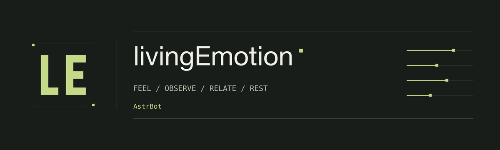

# livingEmotion 🎯

**简体中文** · [English](README.en.md)

LivingEmotion为AstrBot的原生人格增加持续变化的心情、关系、作息和精力，
提供自动刷新的生活控制台；主动聊天、日记、梦境、记忆和承诺按需使用。
状态是软件计算的角色状态，不代表模型具有人的感受。
开发者：[AKIhunter](https://github.com/AKIhunter)，反馈QQ群：991350637。

## 能做什么

| 需求 | 功能 |
| --- | --- |
| 看心情与关系 | 四维规则情绪、展示用底气、开心窗口、好感V2、人工校正 |
| 管作息与精力 | 一个睡眠总开关；关闭立即清醒、精力始终100% |
| 自然开口 | 随机主动机会、话题避重、未回应退避、与宿主主动任务让行 |
| 说了记得做 | 明确延后的承诺落成待办；即时请求当场做，宿主任务去重 |
| 留下经历 | 私人日记、想象梦境、可选本地向量或LivingMemory，读写独立许可 |
| 管理人格和表达 | 原生人格、人物性格预置、独立提示词开关、双主题九区页面 |

## 第一次使用：快速开始

1. 按[安装说明](docs/installation.md)加载，支持AstrBot 4.29.1–4.29.4、Python≥3.12。
2. 打开插件页面 `livingemotion` → 设置 → 快速开始，选择人格方式并保存。
3. 情绪强度先选「平常」；本地规则不需要模型，模型生成与主动发送可先保持关闭。
4. 使用作息时填时区和时间，开启「允许 TA 睡眠」；不希望睡眠影响聊天则关闭。
5. 正常互动后回TA看自动刷新的状态；新安装空态正常。

## 文档

| 你要查什么 | 独立说明 |
| --- | --- |
| 每个功能开关、日常操作 | [使用手册：全部32个开关](docs/user-guide.md) |
| 默认值、参数、单位与边界 | [配置参考：101个参数](docs/config-reference.md) |
| 模块、存储、接口、升级逻辑 | [技术说明](docs/technical-guide.md) |
| 情绪、精力、权限为什么这样运行 | [原理与确定性例子](docs/principles-examples.md) |
| 没状态、不生成、不发送、保存冲突 | [排障手册](docs/troubleshooting.md) |
| 专题与历史证据 | [完整文档索引](docs/README.md) |

## 兼容性、默认与边界

默认启用、active模式；情绪模型、随机主动、自动日记、梦境和长期记忆读写默认关闭，
承诺与允许睡眠默认开启。存量显式配置继续保留，不用新默认值覆盖。
自动作息需有效时区；群主动需总许可与额外群许可，群号空表示全部已知真实QQ群。
私人正文按真实来源隔离。开关开启不保证立即生成或发送。

模型生成可能计费；未知生成/发送不盲重试。`sent`表示宿主受理，不是平台确认送达。
普通使用无需Node、外部CDN或其他插件；完整共享提示词使用LivingHello 2.7.11契约。
可信集成走[API v1](docs/api.md)，不读取其他插件私有配置/数据库。
## 使用指令

管理员命令只有 `le_wake`，前缀以AstrBot配置为准；日常操作使用插件页面。

## 常见问题

保存冲突、状态空白、生成失败或主动不发送，请按[排障手册](docs/troubleshooting.md)逐项核对。

## 0.4.3

合并睡眠与自动作息开关，关闭锁满100%精力；移除参数保存时的隐式授权。
通用说明移到人物性格下方并标为预置，页眉收窄、按钮展开、显示版本。
文档按用途完整拆分。显式allow_sleep优先，旧作息键仅缺失时迁移；
旧allow_sleep=true且schedule=false组合现在按总开关自动作息。
详见[更新日志](CHANGELOG.md)。

本地便携Python2229通过、UI单元16通过、四布局浏览器通过；
这些离线结果不代表真实模型效果或平台最终送达。
