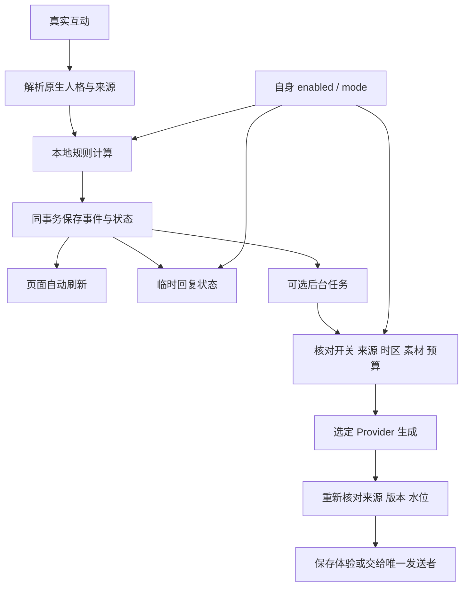

# 架构与状态计算

LivingEmotion 的计算和存储由插件自身实现。领域模块不访问宿主、网络或 SQL；
宿主与可选插件接入集中在适配器，运行时负责装配和授权复核。

| 层 | 文件 | 责任 |
| --- | --- | --- |
| 入口 | `main.py`、`runtime/application.py` | 消息钩子、生命周期、配置与服务装配 |
| 契约 | `contracts.py`、`api.py` | 来源 Context、类型、公开 API v1 |
| 领域 | `domain/` | 情绪、关系、作息与主动机会的纯计算 |
| 投影 | `runtime/projector.py`、`state_scope.py` | 状态还原、共享人格与来源隔离 |
| 存储 | `storage/` | SQLite 短事务、CAS、清除代际、归档、配额与意图 |
| 后台 | `runtime/background.py`、`models.py` | 有界队列、模型预算、用途路由与最终复核 |
| 服务 | `services/` | 行为发送、补课、体验及来源权限 |
| 适配 | `adapters/` | 原生人格、身份、模型、记忆及发送接点 |
| 页面 | `page_api/`、`pages/livingemotion/` | 管理鉴权、九区页面与自动刷新 |

运行期情绪计算愉悦、唤醒、压力和社交需求四维；页面第五维「底气」只由模型写入，
不参与规则和回复注入。强度三档、动态基准和半衰期见[五维情绪](emotion-five-dimension.md)。
对方观察与 Bot 心情分开保存，不把“我很难过”直接当作 Bot 的悲伤。

状态可按人格共享，私人正文仍按真实会话来源隔离。
Context 同时限定实例、Bot、人格、适配器、平台、场景和账号；
同名人格、同群号或相同模型不能代替来源授权。
人格、身份、清除代际或新人消息改变后，在途生成须重新核对。

`effective_mode` 只读取插件自身设置：关闭为 disabled，观察为 observe_only，
其余为 active。模式许可仍须经过发送硬闸门，详见[行为](behavior.md)。
行为使用自身配额、冷却和未回应记录，未知发送不重发。

补课采用自身归档、固定上界、完整分块和成功回执；补答每次唤醒最多三次。
回复计时、票据及晚安见[回复契约](internal-reply-contract.md)。
本地化不把模型变成离线模型：日记、梦境及其他模型用途仍按开关调用 Provider。

SQLite I/O 在线程中执行，事务内不等待模型或网络。
事件、状态和来源贡献同事务提交；清除代际阻止迟到结果回写，持久意图防止重复发送。
自身 schema 升级保留，旧库导入与额外旧约束接管已撤下。
备份使用 SQLite backup 或停写一致快照，升级与回滚见[独立运行说明](local-runtime.md)。

模型支持原生 OpenAI 与 router 指定上游，预算和降级见[兼容矩阵](compatibility.md)。
当前验收结果见[交付与检查](delivery-notes.md)；历史性能报告不代表生产容量或本次全量通过。
