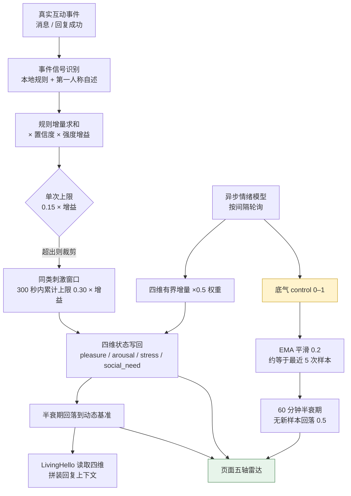
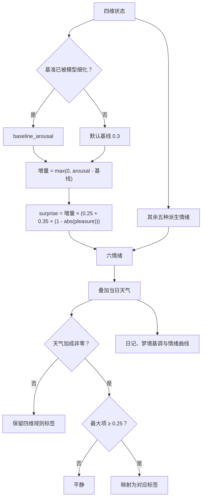

# 五维情绪：四维计算、五维展示

日期：2026-11-12。范围：Bot 情绪的计算、展示与强度档位。
本文记录实现口径、配置入口与离线测试材料；不涉及真实模型调用或消息发送。

## 结论

- 运行期仍只算四维：`pleasure` / `arousal` / `stress` / `social_need`，
  本地规则、半衰期衰减、LivingHello 注入全部保持四维。
- 页面展示第五维「底气（control）」：只由异步情绪模型写入，
  **不参与本地规则、不参与衰减基准、不注入回复模型**。
- 新增情绪强度三档：`gentle`（保守 ×1.35）/ `normal`（平常 ×1.6，默认）/ `intense`（激进 ×2.0）。
  只放大单次增量与两道闸门，不改半衰期。
- 页面雷达由四轴改为五轴，并移除六种派生情绪的展示；
  「六维分析」文本块保留。后续 surprise 修复影响标签、曲线和梦境基调，详见末节。

## 计算逻辑



模型返回的底气先按半衰期衰减到当前时刻，再以 0.2 的 EMA 写入；
`control_at` 与 `updated_at` 分离，写底气不会打断四维情绪的衰减时钟。
旧状态没有这两个字段时按中性 0.5 / 时间 0 处理，无需迁移。

## 维度与回落速度

| 维度 | 范围 | 中性/基准 | 什么情况下升高 | 什么情况下回落 | 半衰期 |
| --- | --- | --- | --- | --- | --- |
| 愉悦 pleasure | 0–1 | 0.5 | 被夸奖、收到关心与感谢、对方开心、承诺兑现 | 被侮辱、冲突、承诺失信、边界被侵犯 | 30 分钟 |
| 唤醒 arousal | 0–1 | 0.3 | 突发消息、冲突、被表扬、重要提醒 | 被安抚、道歉、稳定陪伴、长时间无刺激 | 20 分钟 |
| 压力 stress | 0–1 | 0.0 | 冲突、越界、承诺失信、对方焦虑 | 道歉、边界被尊重、被照顾、互动顺畅 | 40 分钟 |
| 社交需求 social_need | 0–1 | 0.3 | 对方难过/焦虑（想靠近陪伴）、冲突、被忽视 | 收到关心、感谢、回复成功、持续互动 | 60 分钟 |
| 底气 control（仅展示） | 0–1 | 0.5 | 模型判断 TA 此刻回应有把握 | 模型判断 TA 拿不准；无新样本时自然回落 | 60 分钟 |

`control` 的起点与终点都是 0.5，样本越少越接近中性；
它不会出现在 LivingHello 的注入内容里，也不影响任何回复生成参数。

## 强度三档

单次上限 = `0.15 × 增益`，同类刺激 300 秒累计上限 = `0.30 × 增益`：

| 档位 | 配置值 | 增益 | 单次上限 | 同类累计上限 |
| --- | --- | --- | --- | --- |
| 保守 | `gentle` | 1.35 | 0.2025 | 0.405 |
| 平常（推荐） | `normal` | 1.60 | 0.2400 | 0.480 |
| 激进 | `intense` | 2.00 | 0.3000 | 0.600 |

衰减半衰期与基准完全不变；换档只让「变化更快、更明显」，
不会让情绪长期停在极端值。

## 配置与页面位置

- AstrBot 管理面板 → 插件 → livingEmotion → 配置 → 情绪 → **情绪强度**。
- livingEmotion 页面 → 设置 → 情绪分组 → **情绪强度**（三档下拉）。
- 页面 → TA / 情绪页 → 五轴雷达；点击雷达下方问号展开
  「情绪与五维指标说明」，表内数值按当前档位折算。
- 生效方式：在插件自己的设置页保存后更新运行配置；在 AstrBot 原生配置页保存时，
  按宿主提示应用或重载，再回到插件页面核对。仅编辑磁盘 JSON 不能算已生效。

## 测试材料

环境：macOS arm64，插件虚拟环境 `.venv`，Node 25.6.0；
全部为离线测试，无真实模型调用、无消息发送、无生产数据。

### 后端

```bash
cd 插件/astrbot_plugin_livingemotion
.venv/bin/python -m pytest -q
```

| 阶段 | 结果 | 说明 |
| --- | --- | --- |
| 实施前基线 | 28 failed / 1759 passed | 失败清单落盘 `/tmp/le_baseline_fail.txt` |
| 实施后 | 28 failed / 1761 passed | 新增 2 条底气/档位单测 |
| 失败清单比对 | 无新增 | `comm` 逐项比对，28 项均为既有失败 |

既有失败分布（与本改动无关）：`tests/verification/test_cross_module.py` 12 项、
`tests/budgets/test_runtime_budgets.py` 4 项、`tests/identity/test_projection_read.py` 3 项、
`tests/integration/test_proactive_runtime.py` 3 项、`tests/runtime/test_background.py` 2 项，
其余 4 项分别位于 contracts / integration / storage / performance_f6。

新增覆盖：

- `tests/domain/test_emotion.py::ControlTests::test_control_ema_decay_and_rule_independence`
  —— 规则事件不重置底气、无样本按 60 分钟回落。
- `tests/domain/test_emotion.py::ControlTests::test_intensity_presets_scale_deltas_and_gates_only`
  —— 三档只放大增量与闸门，半衰期不变。

### 前端

```bash
cd tests/ui
npm run build
npm test
```

- 构建：通过（仅打包本地 d3-force 依赖）。
- 单测：11 通过 / 1 失败；失败为既有的
  `energyPoints(nativeDTO.energy).collected === false` 断言，
  `native-dto.mjs` 中该字段实施前后均为 `true`，非本次引入。

### 契约与 DTO

- `tests/console/test_management_dto.py` 已同步 `control: 0.5` 基准与五维 DTO。
- `tests/ui/native-dto.mjs` 由 `npm run fixture:native` 重新生成（94 → 95 字段），
  新增字段为 `control`。

## 兼容性与边界

- 配置新增 `emotion_intensity`，旧配置缺省按 `normal` 处理；不改动旧键。
- 持久化新增 `control` / `control_at`，旧状态缺省 0.5 / 0，读写均向后兼容。
- `six_emotions()` 的 joy/anger/sadness/fear/affection 与日记、梦境、曲线、天气加成保持不变；
  `surprise` 改为按「唤醒超出基线的增量」计算（见下节），修复阴天加成下页面长期显示「兴奋」。
- 底气是软件状态，不是心理测量；页面说明已注明不构成心理诊断。

## 页面标签与「兴奋」口径

`bot_state.label` 不是独立测量值：页面打开时，`Console._attach_emotion_curve`
（`runtime/console.py`）把六情绪叠加当日天气加成；加成非零时，取最大项且 ≥0.25 时映射成标签
（`joy→开心`、`anger→愤怒`、`sadness→悲伤`、`fear→焦虑`、`surprise→兴奋`、`affection→关切`）。
无有效天气加成时保留四维规则标签，不执行这条最大值标签分支。

原 `surprise = arousal × (0.25 + 0.35 × (1 − |愉悦|))` 把基线唤醒 0.3 也当成兴奋，
平静时就有约 0.20；阴天（天气代码 2/3）六维各 +0.1 后越过 0.25，标签被固定写成「兴奋」。

现改为：

```text
surprise = max(0, arousal − 基线唤醒) × (0.25 + 0.35 × (1 − |愉悦|))
```

- 基线唤醒默认 0.3；状态被模型轮询细化过（`baseline_refined`）时取 `baseline_arousal`。
- 平静状态 `surprise = 0`；只有唤醒真正高于平常才增长。
- 阴天示例（已只读采集的数值，计算结果为离线推算）：愉悦 0.0361、唤醒 0.3483、
  压力 0.0076、社交需求 0.2492、动态唤醒基线 0.3145、天气代码 3。
  surprise 由 0.2046 降为 0.0199，叠加 +0.1 后为 0.1199；
  最大项变成 affection 0.2103，低于 0.25，标签回到「平静」。

回归覆盖：`tests/experience/test_dream_paper.py::test_surprise_counts_only_arousal_above_baseline`。
控制台标签回归：`test_cloudy_console_label_uses_arousal_increase`，
覆盖默认平静、历史数值、抬高后的动态基准和真正高唤醒四种场景。



范围与限制：修复不改变四维状态、底气、天气加成或标签阈值。旧存量四维采样没有保存
动态基准，历史曲线重算使用默认 0.3；当前完整状态使用其动态基准。
基准本身很高时 surprise 仍可能为零，表示当前唤醒没有超出平常水平。
使用新公式后，以 surprise 为主的抽象梦会减少；这是共用派生情绪口径的预期影响。
