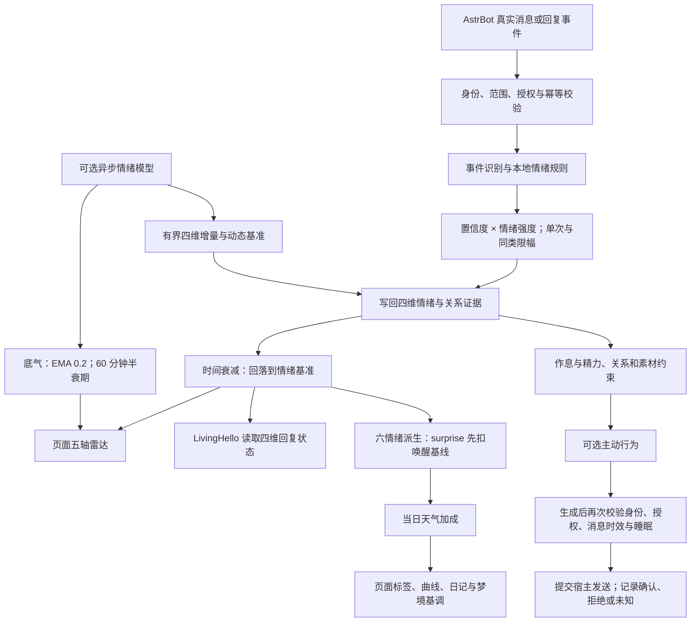

# AstrBot 插件帮助手册：LivingEmotion

开发者：[AKIhunter](https://github.com/AKIhunter)。
插件仓库：[AKIhunter/astrbot_plugin_livingemotion](https://github.com/AKIhunter/astrbot_plugin_livingemotion)。
版本：0.2.0；适用 AstrBot 4.29.1–4.29.4，Python 3.12 及以上。
这是 LivingEmotion 插件的使用手册，宿主安装与账号管理请查 AstrBot 自身文档。

## 第一次使用

1. 在 AstrBot 管理面板安装插件，从插件页面打开 `livingemotion`。
2. 进入「设置 → 快速开始」，选择人格、时区和作息。
3. 在「TA」查看心情、人格、精力和五轴雷达；使用顶部范围选择查看全局、私聊或群聊。
4. 按需开启情绪模型、主动行为、日记、梦境和记忆，并设置各自的模型与授权。
5. 保存配置后按页面提示使配置生效；AstrBot 原生插件配置保存后重启宿主，并核对页面读回值。

配置入口：AstrBot 管理面板 → 插件 → livingEmotion → 配置，或插件页面 → 设置。
页面自动刷新状态；自动刷新不保证模型候选列表立即更新，上游变更后的候选行为见兼容说明。

## 常用功能

| 位置 | 用途 | 开启后的要求 |
| --- | --- | --- |
| TA | 查看心情、五轴雷达和状态说明 | 本地规则无需模型 |
| 关系 | 搜索平台账号，查看与修改关系 | 修改后复核范围与保存结果 |
| 长夜 | 查看作息、精力曲线与事件 | 作息需要有效时区；是否真正入睡由独立配置控制 |
| 主动行为 | 模拟或查看主动聊天记录 | 默认不自主发送，实际发送需完整授权与门禁 |
| 日记与梦境 | 按日期查看、生成和管理正文 | 需启用对应功能、可用模型和有权素材；自动梦境另受睡眠约束 |
| 记忆 | 选择 LivingMemory 或原生向量接口 | 读、写分别开启；关闭开关不会删除既有记录 |
| 设置 | 选择人格、模型、情绪强度和模块开关 | 保存冲突后刷新核对，不用重复点击绕过校验 |

## LivingEmotion 运行流程

四维计算为愉悦、唤醒、压力、社交需求；五轴雷达增加「底气」。
底气只由模型写入并用于展示，独立衰减，不进入本地规则或 LivingHello 回复注入。
详细公式和三档强度表见 [情绪计算说明](emotion-five-dimension.md)。

## 「兴奋」怎么判定

惊讶强度采用 `max(0, 唤醒 − 基线) × (0.25 + 0.35 × (1 − |愉悦|))`。
默认唤醒基线为 0.3，模型细化过后使用状态中的动态基准。
平常唤醒不会自行产生惊讶；明显高于基线时数值才增加。

天气加成非零时，页面取六种派生情绪的最大值：低于 0.25 显示平静，
达到阈值时映射为对应标签，惊讶对应「兴奋」。无有效天气加成时保留规则标签。
标签是软件展示结果；底层四维数值和日记、梦境基调应结合查看。
修复后抽象梦可能减少，历史四维采样重算仍使用默认基线。

## 模型与失败处理

规则情绪不要求 Provider；情绪模型、主动生成、日记与梦境需要各自的模型配置。
当前验证支持原生 `ProviderOpenAIOfficial` 纯文本路径；其他 Provider 不因出现在宿主列表就自动可用。
模型不可用、素材不足、预算用尽或授权不满足时，生成按原因码停止或沿已配置候选链回退。
不通过自动重试发送解决未知回执；`queued`、`accepted` 或提交宿主不等于平台送达。

页面模拟、离线回归与真实生成的边界不同。离线回归使用合成模型和虚拟素材，
不代表真实模型质量或实际投递验证；收费模型测试应单独授权。

## 命令与协作接口

`le_wake` 供已认证管理员手动叫醒，实际命令前缀以 AstrBot 配置为准。
没有 `/livingemotion ...` 命令族。
跨插件协作走公开 `plugin.api` v1 门面，见 [接口说明](api.md)；
LivingHello 协作读取四维状态，不共享跨场景私人正文。

## 常见问题与更多说明

- 心情一直兴奋：确认已升级修复，查看唤醒与基线的差值，以及当日天气加成。
- 开关关闭仍有记录：开关不负责删除状态、关系、短期归档或已产生的额度记录。
- 模型候选存在但不能生成：检查 Provider 类型、预算、时区与对应功能开关。
- 配置保存发生冲突：刷新后读取当前值再操作，不重复提交旧版本。
- 安装、版本与迁移：[安装](installation.md)、[兼容矩阵](compatibility.md)、[迁移与回退](migration.md)。
- 变更记录：[CHANGELOG](../CHANGELOG.md)；本次修复验证：[surprise 回归材料](verification-surprise.md)。
