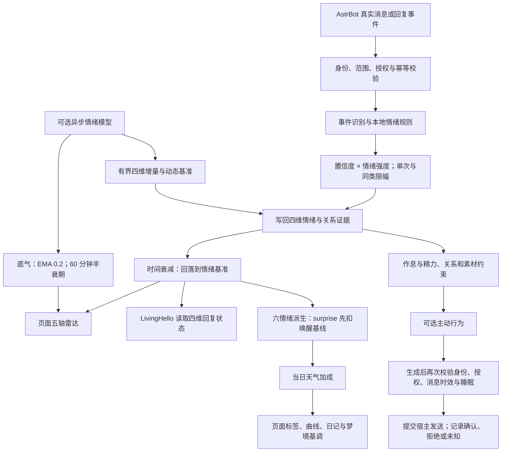

# AstrBot 插件帮助手册：LivingEmotion

开发者：[AKIhunter](https://github.com/AKIhunter)。
插件仓库：[AKIhunter/astrbot_plugin_livingemotion](https://github.com/AKIhunter/astrbot_plugin_livingemotion)。
版本：0.2.0；适用 AstrBot 4.29.1–4.29.4，Python 3.12 及以上。
这是 LivingEmotion 插件的使用手册，宿主安装与账号管理请查 AstrBot 自身文档。

## 第一次使用

先按 [安装说明](installation.md)下载插件源码并加载。
首次体验只需要本地规则情绪，不用先配置情绪模型。

1. 在 AstrBot 插件页面打开 `livingemotion`，进入「设置 → 快速开始」。
2. 选择人格方式：“跟随”使用当前聊天的人格；“指定”需要再选下面的人格。
   只改下方人格、不切换方式，不会固定角色。
3. 情绪强度先保留“平常”，把情绪模型、主动聊天和自动日记/梦境留在关闭状态。
4. 需要作息时填写时区，中国大陆填 `Asia/Shanghai`，再核对睡眠、起床和午休时间。
   在插件设置里保存时区或作息会启用时间表。若不希望睡觉影响回复，
   把“允许 TA 睡眠”关闭；精力和疲劳仍会记录。
5. 点保存，看到保存成功后返回 TA，选中你的人格查看心情与雷达。
   新库没有互动记录时显示“未采集”正常，不能把空态理解为插件故障。

页面会自动刷新状态，你不需要不断点击刷新。
新增或修改宿主模型后，如果候选列表尚未出现，重新进入设置页再检查；
状态自动刷新与模型候选更新不是同一件事。

## 保存以后，怎么确认真的生效

| 从哪里改 | 操作步骤 |
| --- | --- |
| 插件页面 → 设置 | 修改后点保存；插件会保存并替换运行配置，通常无需重启整个 AstrBot |
| AstrBot 管理面板 → 插件 → livingEmotion → 配置 | 保存后按宿主提示应用或重载，再打开插件设置核对值 |
| 直接编辑 JSON 文件 | 文件改了不代表运行中的插件已更新；应用配置或重启后，必须回页面核对 |

例如把情绪强度从“平常”改成“保守”：保存成功后离开设置，再进入，
确认仍显示“保守”。这检查的是配置是否保存和读回，不要求心情马上变成某个标签。
作息还要检查长夜页的时间；主动聊天还要检查实际授权号码和失败原因。
遇到“版本冲突/409”时，重新打开设置读当前值，再修改，别连续点击保存旧数据。

## 五轴雷达怎么看

雷达是把五个数值画在同一张图上，方便比较当前状态与基准。
“基准”就是平常水平，不是全都归零。

| 指标 | 用大白话理解 |
| --- | --- |
| 愉悦 | 心情偏好还是偏差；页面中性值为 50%，并不代表已经开心了一半 |
| 唤醒 | 有多活跃、多容易被刺激；平常基线约 30%，不等于兴奋 |
| 压力 | 有多紧绷 |
| 社交需求 | 有多想与人互动 |
| 底气 | 有多有把握；由情绪模型给出，没有新样本时逐渐回到 50% |

前四项参与本地情绪规则；底气只展示，不改变 LivingHello 的回复情绪注入。
顶部“开心、平静、关切、兴奋”等文字是综合标签，不是直接把某一个轴改名。

## 情绪强度该选哪档

位置：插件页面 → 设置 → 情绪 → 情绪强度。

| 档位 | 适合谁 | 效果 |
| --- | --- | --- |
| 保守 | 嫌一两句话就起伏太大 | 同样的刺激造成较小变化 |
| 平常（推荐） | 第一次用，不知道如何选择 | 默认档位 |
| 激进 | 希望角色反应更明显 | 同样的刺激造成较大变化 |

强度只改变每次变化幅度和短时间内的累计上限，不改变恢复速度。
改档位不会立刻清空已有心情，也不能保证下一句就变成“开心”。
不想产生情绪模型费用时，关闭情绪模型即可保留本地规则情绪。

## 常用功能

| 位置 | 用途 | 开启后的要求 |
| --- | --- | --- |
| TA | 查看心情、五轴雷达和状态说明 | 本地规则无需模型 |
| 关系 | 搜索平台账号，查看与修改关系 | 修改后复核范围与保存结果 |
| 长夜 | 查看作息、精力曲线与事件 | 作息需要有效时区；是否真正入睡由独立配置控制 |
| 主动行为 | 模拟或查看主动聊天记录 | 默认不自主发送，实际发送需完整授权与门禁 |
| 日记与梦境 | 按日期查看、生成和管理正文 | 需启用对应功能、可用模型和有权素材；自动梦境另受睡眠约束 |
| 记忆 | 选择 LivingMemory 或原生向量接口 | 读、写分别开启；关闭开关不会删除既有记录 |
| 设置 | 选择人格、模型、情绪强度和模块开关 | 保存冲突后刷新核对，不用重复点击绕过校验 |

## LivingEmotion 运行流程

四维计算为愉悦、唤醒、压力、社交需求；五轴雷达增加「底气」。
底气只由模型写入并用于展示，独立衰减，不进入本地规则或 LivingHello 回复注入。
详细公式和三档强度表见 [情绪计算说明](emotion-five-dimension.md)。

## 「兴奋」怎么判定

先看“唤醒比平常高了多少”。平常是 30%、现在也是 30%，就没有额外兴奋；
现在明显高于平常，惊讶强度才上升。
模型分析可以更新平常水平，所以有动态基准的状态会扣除自己的基准。

旧版把平常唤醒也算进了惊讶。阴天再加一点天气影响后，就容易一直显示兴奋。
修复后，默认平静状态在阴天下仍能显示平静；角色当时已经有明显关怀或快乐时，
也可能显示“关切”或“开心”，并不要求全部变成“平静”。

程序先从四维状态算出六种情绪，再叠加天气影响。
有天气加成时，取最强的一项，达到 25% 才显示对应标签；惊讶对应“兴奋”。
没有有效天气加成时保留本地规则标签。准确公式与分支流程见
[计算说明](emotion-five-dimension.md#页面标签与兴奋口径)。
梦境也使用这些情绪，新版以惊讶为主的抽象梦可能减少；
旧历史记录没有存动态基准时，曲线重算仍使用默认 30%。

## 模型与失败处理

“模型提供商/Provider”就是 AstrBot 中接入模型的那条配置。
先在宿主配置好，再从本插件下拉框选择。

支持原生 OpenAI 类型的聊天模型，以及 multi_api_router 中单独指定的
`multi_api_router:upstream_N`。后者的 N 对应路由当前的指定上游编号；
调整路由列表后应重新核对这里实际选中的模型。
聊天模型用来生成文字；向量/embedding 模型用来检索本地记忆，两者不能互相替代。

先选通用后台模型。日记、梦境、主动聊天等可以另外选专用模型；
专用模型留空时沿用通用模型。通用模型也留空时，需要已保存的真实聊天来源，
才能尝试使用该聊天当前的模型；新安装没有聊天来源时建议明确选一个。
备用模型主要用于请求发出前发现主模型不可用的情况，
不承诺超时后自动重发，也不保证每个任务都会产生结果。

开启情绪模型可能产生模型服务商费用。默认最少间隔 10 分钟，
凌晨 03:00–08:00 跳过模型情绪分析；还要有新素材、可用模型和剩余额度。
这不是“每十分钟必定调用一次”的定时承诺。

使用自动梦境需开启梦境功能并满足睡眠条件；手动生成梦境也要开启梦境功能，
但不要求当时正在睡觉。手动日记和自动日记的开关要求不同，
“自动日记关闭”不等于禁止你手动生成。模型、人格和预算仍必须可用。

任务状态里，“排队/queued”表示还在等待，“已接受/accepted”只表示插件接受了任务或事件，
不能理解成已经发到 QQ。“结果未知/unknown”表示没有可靠确认，不会自动再发一遍。
模型不可用、素材不足或额度耗尽时，按页面提示处理；不要用反复点击生成解决超时。

## 命令与协作接口

`le_wake` 供已认证管理员手动叫醒，实际命令前缀以 AstrBot 配置为准。
没有 `/livingemotion ...` 命令族。
跨插件协作走公开 `plugin.api` v1 门面，见 [接口说明](api.md)；
LivingHello 协作读取四维状态，不共享跨场景私人正文。

## 遇到问题，按这个顺序检查

| 现象 | 先检查什么 | 下一步 |
| --- | --- | --- |
| 打不开 GitHub 仓库或显示 404 | 仓库链接是否正确，网络是否能访问 GitHub | 从本手册顶部打开仓库链接；当前仓库公开，可以直接查看 |
| 页面没有状态 | 是否选了正确人格，是否已有真实聊天记录 | 正常互动后等自动刷新；“未采集”不是随机生成一个值 |
| 配置改完又恢复旧值 | 保存是否成功，是否有版本冲突 | 重新打开设置核对；冲突时读最新值再改 |
| 仍显示兴奋 | 是否已安装包含 surprise 修复的代码 | 查看唤醒和基准；高唤醒时显示兴奋仍是正常结果 |
| 底气一直是 50% | 情绪模型是否开启、有没有有效新样本 | 关闭模型或没有样本时保持/回到中性是正常的 |
| 模型下拉框找不到想用的模型 | 宿主模型配置和提供商类型是否受支持 | 重新进入设置页；不要把聊天模型填进向量模型栏 |
| 主动开关开了却不发消息 | 号码、已有聊天来源、作息、静默和每日额度 | 开关表示允许尝试，不代表立即发；先看主动行为页的原因 |
| 关闭记忆还有记录 | 关闭读取/写入不等于删除 | 状态、关系和历史记录需按各自管理操作处理 |
| 不想睡觉导致不回复 | 是否启用了“允许 TA 睡眠” | 关闭该项，精力和疲劳表达仍继续记录 |

第一次开主动私聊时，只填写你已经与 Bot 正常聊过的 QQ 号码；
填号码不会替你建立聊天连接。群聊开关独立，**开启群主动且群号留空会覆盖所有已知真实群**，
只想在少数群使用时应先填群号。关群主动不会靠私聊名单自动开启群发言。

使用与原理见 [生活控制台](life-console.md)；安装、版本与迁移见
[安装](installation.md)、[兼容矩阵](compatibility.md)、[迁移与回退](migration.md)。
开发者与维护者的接口、测试和历史材料分别见 [API](api.md)、
[surprise 回归材料](verification-surprise.md)、[交付记录](delivery-notes.md)。
变更记录见 [CHANGELOG](../CHANGELOG.md)。测试数字只代表对应测试范围，
不等于所有模型都实测可用或已经确认平台送达。
