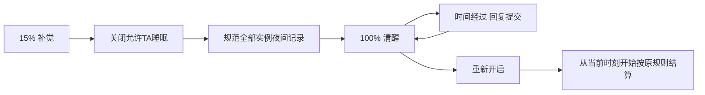

# 原理与例子

适用0.4.3。读者：想理解状态变化的用户和维护者。
2026-11-19按领域规则与离线测试核对；公式、阈值或许可变化时同步。
下列数值是**按给定条件推算的例子**，不是生产trace、模型usage或账单实测。
如何开启功能见[使用手册](user-guide.md)，完整算法见[技术说明](technical-guide.md)。

## 关闭睡眠：为什么一直100%

假设已有记录精力15%，正在补觉。关闭allow_sleep：

即使期间产生10次有效回复、经过60分钟，关闭状态仍100%。
再开启不会追扣这10次回复或60分钟；后续按已有耗能参数运行。
修改起床时间不会自动把总开关打开。

## 精力、补觉与唤醒

条件：allow_sleep开启，v2、有效时区、非固定夜间、白天恢复关闭，
初始100%、每有效回复2点。10次首次有效提交后：`100−10×2=80%`。
同回复分段/重复回调不重复扣；生成失败占唤醒轮数，但不产生有效提交扣费。

非睡眠精力20%是恍惚，0%是困。困/恍惚连续安静30分钟才补觉；
新鲜人类消息或有效回复重置静默计时。补觉恢复到20.0%仍沉睡，
到20.1%才转小憩，满100%或截止退出。
小憩可按wake_mode被聊天唤醒，沉睡不能；管理员叫醒不奖励精力。

夜间例子：02:30固定沉睡、基础08:00起床、本周期已抽赖床30分钟。
实际08:30起床；即使03:30已回满，也继续固定沉睡到08:30。
重启和刷新不会再抽一个不同赖床数。

补觉例子：关闭recovery_follow_wake_at，最长120分钟，起始0%、恢复0.1点/分钟。
120分钟截止精力12%，按当前精力退出，**不强制补满**；重新计算30分钟静默。
这些算例没有叠加额外消息或其他作息边界。

## 开心不是每句夸奖无限叠加

最近300秒开心事件上涨累计最多5个百分点、下跌最多10个百分点，方向各自记账。
假设已消耗上涨4点，再有一个拟上涨3点的有效刺激，剩余上涨预算1点，只能再涨1点。
同窗口下跌预算仍可用，普通聊天和主体不明确不会伪造额外开心。
自然回落、动态基准和天气影响另算，不计这份刺激预算。

情绪强度只改增量与限幅：给定规则增量0.1、置信度0.8、normal增益1.6，
限幅前是 `0.1×0.8×1.6=0.128`，随后还需单次、同类及开心预算复核。
不能把这个中间数当作最终页面开心变化。底气仅模型写入，不参与这条规则。

## 对方难过，不等于Bot被改成难过

“我今天很难过”首先是一条关于对方的观察。插件可记录它，Bot随后如何回应
由自身情绪、关系和人格决定；它不会把对方的句子直接写成Bot当前情绪。
动态状态和私人正文也分开：人格共享可以共享精力数值，不能共享别的私聊内容。

## 好感与生图概率

明确指向Bot的夸奖可加0.5显示分，实质帮助或履约可加1分。
普通聊天、转述、否定或对象不明为0，正负日预算分别2.4分。
人工编辑0.1步进与自动计分0.5–1是两个入口。

若默认友好阶段婉拒概率30%，测试固定抽样值0.2会婉拒、0.8会接受。
同请求只抽一次，不能换工具或登记定时任务绕过本轮婉拒；既有承诺继续履行。
这是固定随机值的演示，不是100次真人请求必定恰好30次拒绝。

## 主动许可是检查链

开启autonomy_enabled并填QQ，仍需已存在真实私聊、active模式、有效时区、
可用素材、睡眠可用、活动时段、免打扰外、冷却结束及每日额度。
若随机等待90–240分钟抽到120分钟，到点只是检查；发现对方5分钟前刚说过话、
安静时间要求20分钟，就跳过此次开口。
group_autonomy_enabled是额外许可，总开关关闭时群开关不能自行发送。

## 日记和梦境为什么会跳过

自动日记关闭，管理员可手动日记，但仍需人格、合法素材、模型和预算。
dream_enabled关闭则手动梦境也拒绝。自动梦境要求睡满60分钟且仍同周期未起床：
13:00午休、14:30结束，14:00之后有评估机会；睡眠总开关关闭就没有自动睡眠来源。

输出2000个汉字可能约6000个UTF-8字节；2000是正文**字符**上限，
不能把6000字节当作6000个输出Token而误拒。
8192是该任务请求的输出Token预算，不是实测usage或必定生成长度。
选素材后普通情绪更新不取消文章；清除状态或撤销身份授权仍会取消迟到写回。

## 承诺、宿主任务与未知结果

“现在发张图”走即时动作；“10分钟后发张图”才是明确延后事项。
宿主future_task已成功登记的同事项由宿主执行，不能再写promise标记重复登记。
取消只有一条时直接处理，多条先明确对象。

图片生成已确认、发送明确拒绝时，可重发已生成原图；生成或发送结果未知，
可能已收费或投递，自动停止盲重试。cron完成摘要不是平台送达证据，
页面sent表示宿主已受理。如何查实际原因见[排障](troubleshooting.md)。
