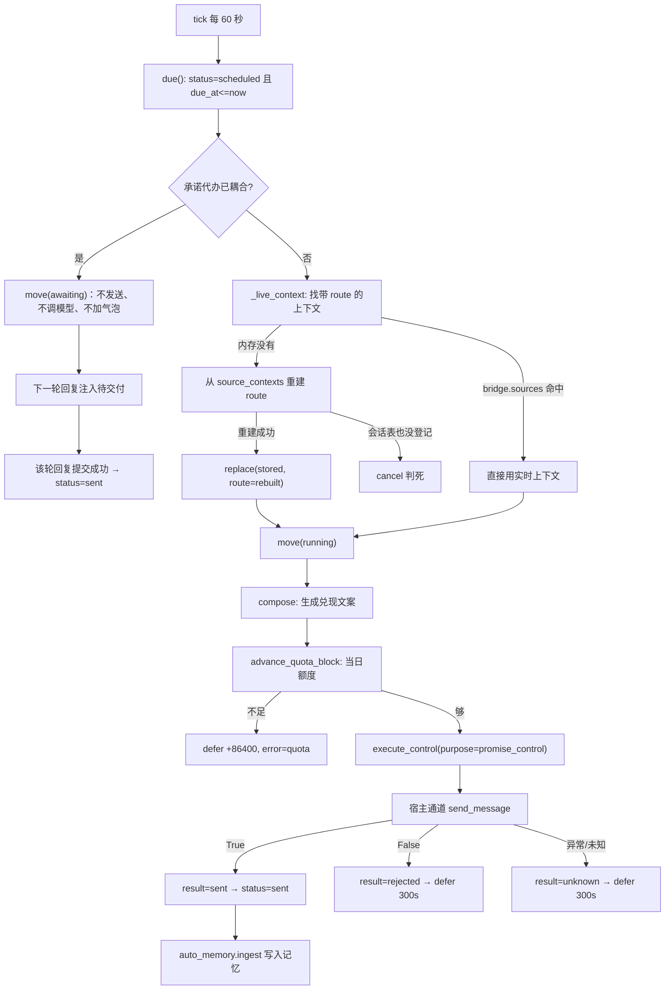

# 承诺任务：识别、兑现与取消

> 适用版本 0.3.0 及以上。默认开启（`promise_enabled=true`）。

## 一句话

模型在回复里答应过的事，会被记成一条带时间的待办；到点由插件自己把话说完，
不需要用户再催一遍。

## 标记与识别

回复正文末尾带一个装饰阶段会被剔除的注释标记：

```
<!--promise:一会儿:把昨晚那首歌找出来发你-->
<!--promise-cancel:2-->
```

| 形态 | 含义 |
| --- | --- |
| `<!--promise:档位:描述-->` | 新建一条待办。档位决定落点，描述是这件事本身 |
| `<!--promise-cancel:编号-->` | 取消第 N 条 |
| `<!--promise-cancel:关键词-->` | 按描述关键词取消 |

用户永远看不到标记：`on_decorating_result` 阶段就把它从正文里删掉了。
落库时机固定在 `on_reply_submitted`——消息没真正发出去，就不建任务，
避免“用户没看见那句话，任务却排上了”的幽灵待办。

同一 `(scope_key, 描述归一化)` 只保留一条。措辞相同但时间更早的，会把已有那条提前
（`advanced`）；时间更晚的按重复处理（`duplicate`）；已经到点、正等下一轮回复的
（`awaiting`）同样算在队列里，不会再建第二条。

`already_sent` 的窗口是 **10 分钟**，不是一天。这条规则只用来挡住同一条回复被重复
提交造成的双份任务；提醒类措辞（「十分钟后提醒我出门」）一天里本来就会反复出现，
24 小时窗口会把第二次请求静默吞掉，用户以为根本没记上。

## 时间档

| 档位 | 落点 | 随机范围 |
| --- | --- | --- |
| 马上 | 2–5 分钟后 | 120–300 秒 |
| 一会儿 | 15–30 分钟后 | 900–1800 秒 |
| 待会 | 40–70 分钟后 | 2400–4200 秒 |
| 今晚 | 当天 20:00–22:59 | 早于当前时间则顺延一天 |
| 明天 / 过几天 | 次日或数日后的同一时段 | 按天数偏移 |

档位由模型给出，落点由本地时钟算，不依赖模型输出时间戳。

## 状态机

```
scheduled ──move──> running ──> sent
    │                  │
    │                  ├──> failed      （重试耗尽或终态失败）
    │                  └──> unknown     （结果不可判定，随后自愈回 scheduled）
    ├──> awaiting ──> sent             （耦合生效：到点不发送，随下一轮回复交付后落 sent）
    ├──> cancelled                    （用户取消 / 会话消失）
    └──> failed                       （配额、内容、夜间等重试耗尽）
```

`TRANSITIONS` 在存储层硬校验，非法跳转会返回 `conflict` / `illegal`，
调用方不能凭意愿改状态。重启后卡在 `running` / `unknown` 的会在启动时被
`reclaim()` 拉回 `scheduled`，不会永久卡死。

## 兑现流程



### 为什么耦合时改成并轨

耦合生效时，兑现不再单独发一条。原因很实在：同一轮对话里 LivingHello 已经回过一次，
LivingEmotion 再发一条「之前说好的……」必然是第二份话，内容还高度重合。

所以到点只做两件事：`move(awaiting)`，等下一轮回复把结果带出去。三个关键点：

1. **不调模型。** 为一句承接语再调一次模型纯属浪费，而且会和被动回复的语气打架。
2. **不在注入时落 sent。** 注入只登记候选 id；模型完全可能一个字都没提、
   甚至反口说「还没到、还没弄」，那时候落 sent 就是假交付——面板显示已兑现，
   实际什么都没给。确认点放在回复提交成功之后（`_confirm_awaiting_delivery`）。
3. **注入是硬指令。** 到点那轮明确解除「先别生成」的限制，并禁止「还没做」
   「还没拍」「还没到」这类推脱话术；否则模型会把待交付项当成闲聊话题，
   顺口编一句「我还没拍呢」——用户看到的就是自相矛盾。

把「承诺代办」切回 `off` 时，攒着的 `awaiting` 会被 `release_awaiting` 放回队列，
按老路单独发一条，不会永远卡住。

### 为什么兑现要脱离实时事件

`route` 落库时一律置空（`canonical_json(replace(context, route=None))`），
而 `bridge.sources` 是内存里的最近 128 个来源，重启即清空。
如果坚持“必须有实时来源才能发”，那么任何跨越重启的承诺都发不出去——
它只能干等用户先说话。

钥匙是 `route` 可以重建：

```
f"{adapter_id}:{FriendMessage|GroupMessage}:{scene_id}"
```

这三个字段都在 `source_contexts` 里，与宿主 `MessageSesion` 的规则一致。
重建值必须与 `context.route` 逐字相等才放行，否则宁可拒发也不乱投。

对应地，授权链上有五道闸门都需要“允许来源由会话表重建”的版本：

| 闸门 | 严格版 | 承诺用 |
| --- | --- | --- |
| 上下文校验 | `validate_context`（要求实时事件） | `validate_delivery` |
| 行为身份 | `validate_identity` | 构造时注入 `validate_delivery` |
| 夜间静默 | 需 `_reply_contexts` 有正在进行的回复 | delivery 直接放行 |
| 发送路由 | `recorded_route` 只查内存 | 桥接层回退会话表重建 |
| 事件登记 | `api.py` 对带 route 的上下文一律严格校验 | `bot_reply_submitted` 放宽 |

### 为什么走宿主通道

`snowluma_onebot` 这类反向 WS 适配器上，`event.bot.send_private_msg` 会返回
`{"status":"ok","retcode":0,"data":{"message_id":-1753358555}}`，
看起来是 `confirmed`，但消息实际没有落地。这类回执不可信。

承诺固定走宿主的 `send_message(route, chain)`：回执只能到 `unknown`，
由 `SendReceipt.channel == "host"` 标记来源，业务层按「适配器已接手」记为 `sent`。
这样宁可少一个 message_id，也不冒“以为发了其实没发”的风险。

### 为什么兑现要写记忆

正常回复在 `record_host_submission` 里做两件事：`ingest_event` 登记事件，
`auto_memory.ingest` 写入长期记忆。承诺兑现如果只做前者，结果是：
消息发了、日志有、记忆没有——用户回头问“你刚才说什么”，它答不上来。

写入路径上还有两道必须放宽的判定：归属账号（无实时事件时从 `audience`
里取 bot 自己的账号）、原生归档作用域（拿不到真实 event 时退回按 route 归档）。

## 夜间与配额

- **夜间不拦承诺。** `_preparation_guard` 在 delivery 模式下直接放行 `block_chat`，
  作息表只约束主动闲聊。真发不出去（深睡且唤醒窗口已过）时，
  用 `no_penalty` 推迟到醒来，不消耗重试次数——否则跨夜承诺三次就永久 `failed`。
- **配额与主动行为共用 `send` 池**（`behavior_daily_limit`，默认 20）。
  被拒、未知、真的发出去都算一次。配额不足时 `defer` 到次日同一时刻。
  如果承诺频繁发不出去，先看 `last_error` 是不是 `quota`。

## 取消语义

| 情况 | 行为 |
| --- | --- |
| 只有一条待办 | 直接取消，不追问 |
| 多条待办且用户说了编号 | 取消对应那条 |
| 多条待办且只说了“不用了” | 列出编号让用户选，不猜 |
| 说了关键词 | 按描述匹配；唯一命中才取消 |

取消是终态（`cancelled`），不会再被 tick 扫到。

## 控制台展示

「主动行为」页顶部是承诺挂载区，数据随 `records` 请求一起返回：
`{enabled, items[]}`，每项包含 `promise_id` / `description` / `status` /
`bucket_label` / `eta_seconds` / `advance_count`。

「允许写入」这类能力显示读的是真实后端能力，不是导出能力——
`caps.append_experience` 表示“能不能导出体验”，拿它当“能不能写对话记忆”
会永远显示关闭。

## 配置项

| 字段 | 默认 | 说明 |
| --- | --- | --- |
| `promise_enabled` | `true` | 总开关；关闭后既不新建也不兑现 |
| `promise_max_active` | `3` | 单会话同时挂起的上限 |
| `promise_max_depth` | `3` | 嵌套深度上限 |
| `promise_advance_limit` | `3` | 单日提前次数上限 |
| `promise_tick_seconds` | `60` | 到期扫描间隔 |

## 排错

| 现象 | 先看 |
| --- | --- |
| 页面没有承诺卡片 | 那条回复是否带了标记；`promise_enabled` 是否为真 |
| 卡片一直在“排队中” | `due_at` 是否还没到；当天 `send` 池是否耗尽 |
| 状态 `failed` | `last_error`：`quota` 额度不足 / `rejected` 被拒 / `context_unavailable` 来源缺失 |
| 收到了但追问不记得 | `documents` 表里有没有 `content_kind=bot_action` 的记录 |
| 同一条发了两次 | 检查是否跨了两个意图世代，或 `fingerprint` 归一化未命中 |
