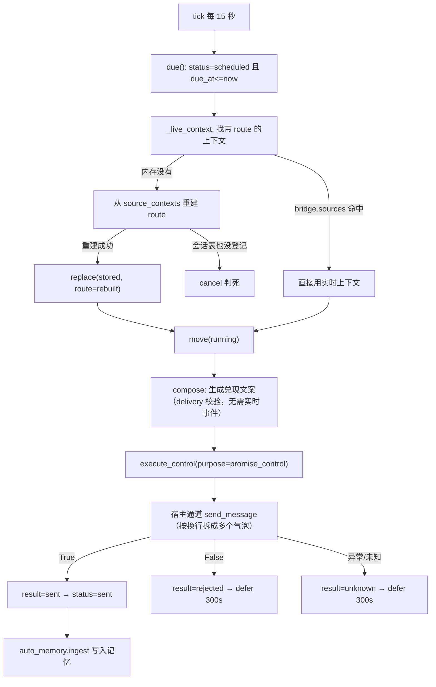

# 承诺任务：识别、兑现与取消

> 适用版本 0.3.0 及以上。默认开启（`promise_enabled=true`）。
>
> 本文只讲 **Bot 自己应下的** 这一类。用户明确要求"提醒我/每天几点叫我"
> 属于另一类，走宿主 `future_task`，边界见 [未来事件任务](future-tasks.md)。

## 一句话

模型在回复里答应过的事，会被记成一条带时间的待办；到点由插件自己把话说完，
不需要用户再催一遍。

## 标记与识别

回复正文末尾带一个装饰阶段会被剔除的注释标记：

```
<!--promise:一会儿:把昨晚那首歌找出来发你-->
<!--promise-cancel:2-->
```

| 形态 | 含义 |
| --- | --- |
| `<!--promise:档位:描述-->` | 新建一条待办。档位决定落点，描述是这件事本身 |
| `<!--promise-cancel:编号-->` | 取消第 N 条 |
| `<!--promise-cancel:关键词-->` | 按描述关键词取消 |

用户永远看不到标记：`on_decorating_result` 阶段就把它从正文里删掉了。
落库时机固定在 `on_reply_submitted`——消息没真正发出去，就不建任务，
避免“用户没看见那句话，任务却排上了”的幽灵待办。

同一 `(scope_key, 描述归一化)` 只保留一条。措辞相同但时间更早的，会把已有那条提前
（`advanced`）；时间更晚的按重复处理（`duplicate`）；已经到点、正等下一轮回复的
（`awaiting`）同样算在队列里，不会再建第二条。

`already_sent` 的窗口是 **10 分钟**，不是一天。这条规则只用来挡住同一条回复被重复
提交造成的双份任务；提醒类措辞（「十分钟后提醒我出门」）一天里本来就会反复出现，
24 小时窗口会把第二次请求静默吞掉，用户以为根本没记上。

## 时间档

| 档位 | 落点 | 随机范围 |
| --- | --- | --- |
| 马上 | 2–5 分钟后 | 120–300 秒 |
| 一会儿 | 15–30 分钟后 | 900–1800 秒 |
| 待会 | 40–70 分钟后 | 2400–4200 秒 |
| 今晚 | 当天 20:00–22:59 | 早于当前时间则顺延一天 |
| 明天 / 过几天 | 次日或数日后的同一时段 | 按天数偏移 |

除了语义档，档位字段还可以直接写**确切延后**：`2分钟` `10分钟后` `90秒`
`1小时` `半小时`。用户既然说了数字，落点就必须是这个数字——把「2 分钟后」
映射到「马上」会随机成 2–5 分钟，实测写过 264 秒，用户看到的就是
「明明说 2 分钟，怎么变成四分钟」。

档位由模型给出，落点由本地时钟算，不依赖模型输出时间戳。

## 状态机

```
scheduled ──move──> running ──> sent
    │                  │
    │                  ├──> failed      （重试耗尽或终态失败）
    │                  └──> unknown     （结果不可判定，随后自愈回 scheduled）
    ├──> cancelled                    （用户取消 / 会话消失）
    └──> failed                       （配额、内容、夜间等重试耗尽）
```

`TRANSITIONS` 在存储层硬校验，非法跳转会返回 `conflict` / `illegal`，
调用方不能凭意愿改状态。重启后卡在 `running` / `unknown` 的会在启动时被
`reclaim()` 拉回 `scheduled`，不会永久卡死。

## 兑现流程



### 为什么到点必须自己发

曾经试过相反的做法：到点不发送，把承诺标成 `awaiting`，等下一轮回复顺带交付。
好处是不会和被动回复撞车，坏处是**用户不开口就永远不提醒**——实测一条
「2 分钟后提醒我关火」从 00:41 挂到 00:58，直到手动放回队列才发出去。

现在恢复成到点直发，同时解决当初想躲的问题：

1. **不并进正在生成的回复。** 到点触发时没有正在进行的回复，单独发一条不会重复；
   真正会重复的是「同一轮里既走被动回复又走承诺」，那条路本来就不存在。
2. **文案允许无实时事件生成。** 兑现发生在到点那一刻，用户上一次说话可能
   隔了几十分钟、甚至跨了一次重启。`purpose_model(delivery=True)` 走
   `validate_delivery`，选模型和执行各有一道闸门都要同步放宽，否则会在
   170ms 内抛 `context_changed` 退成死模板。
3. **快。** tick 从 60 秒降到 15 秒，实测 2 分钟的承诺在到期后 5 秒发出。

如果哪天真要「并入下一轮」，正确的做法是判断"此刻是否正在生成回复"，
而不是无条件下沉——否则就是把提醒变成待办。

### 为什么兑现要脱离实时事件

`route` 落库时一律置空（`canonical_json(replace(context, route=None))`），
而 `bridge.sources` 是内存里的最近 128 个来源，重启即清空。
如果坚持“必须有实时来源才能发”，那么任何跨越重启的承诺都发不出去——
它只能干等用户先说话。

钥匙是 `route` 可以重建：

```
f"{adapter_id}:{FriendMessage|GroupMessage}:{scene_id}"
```

这三个字段都在 `source_contexts` 里，与宿主 `MessageSesion` 的规则一致。
重建值必须与 `context.route` 逐字相等才放行，否则宁可拒发也不乱投。

对应地，授权链上有五道闸门都需要“允许来源由会话表重建”的版本：

| 闸门 | 严格版 | 承诺用 |
| --- | --- | --- |
| 上下文校验 | `validate_context`（要求实时事件） | `validate_delivery` |
| 行为身份 | `validate_identity` | 构造时注入 `validate_delivery` |
| 夜间静默 | 需 `_reply_contexts` 有正在进行的回复 | delivery 直接放行 |
| 发送路由 | `recorded_route` 只查内存 | 桥接层回退会话表重建 |
| 事件登记 | `api.py` 对带 route 的上下文一律严格校验 | `bot_reply_submitted` 放宽 |

### 为什么走宿主通道

`snowluma_onebot` 这类反向 WS 适配器上，`event.bot.send_private_msg` 会返回
`{"status":"ok","retcode":0,"data":{"message_id":-1753358555}}`，
看起来是 `confirmed`，但消息实际没有落地。这类回执不可信。

承诺固定走宿主的 `send_message(route, chain)`：回执只能到 `unknown`，
由 `SendReceipt.channel == "host"` 标记来源，业务层按「适配器已接手」记为 `sent`。
这样宁可少一个 message_id，也不冒“以为发了其实没发”的风险。

### 为什么兑现要写记忆

正常回复在 `record_host_submission` 里做两件事：`ingest_event` 登记事件，
`auto_memory.ingest` 写入长期记忆。承诺兑现如果只做前者，结果是：
消息发了、日志有、记忆没有——用户回头问“你刚才说什么”，它答不上来。

写入路径上还有两道必须放宽的判定：归属账号（无实时事件时从 `audience`
里取 bot 自己的账号）、原生归档作用域（拿不到真实 event 时退回按 route 归档）。

### 兑现时的上下文与气泡

到点生成不只拿一句描述。承诺建立时会把最近几轮对话压成概要写进
`context_summary`，并趁真实事件还在做一次记忆召回快照（`promise_traces`）；
到点时读快照、必要时补召回，再让模型说一到三句、自己断句。
正文走 `clean_delivery` 保留标点与换行，发送层按换行拆成多个气泡。
兑现后片段留一天，用户追问直接命中，不再跑向量检索。
细节见 [承诺兑现的上下文与片段缓存](promise-memory.md)。

## 夜间与配额

- **夜间不拦承诺。** `_preparation_guard` 在 delivery 模式下直接放行 `block_chat`，
  作息表只约束主动闲聊。真发不出去（深睡且唤醒窗口已过）时，
  用 `no_penalty` 推迟到醒来，不消耗重试次数——否则跨夜承诺三次就永久 `failed`。
- **承诺兑现不占主动行为额度。** 它走独立的 `promise` 池，只留统计痕迹，
  不受 `behavior_daily_limit` 约束。理由很直白：这是用户点名要的东西，
  不是机器人自己想说话；共用额度会导致「聊得多的日子，答应的事反而发不出来」。
- 消耗额度的是：情绪波动触发的搭话、按配置随机时间发起的主动聊天、
  从记忆里挑未聊过的话题、以及依据此前承诺发起的主动闲聊。
- 主动行为的正文按换行拆成多个气泡依次发送，间隔 0.35 秒，最多 6 条。

## 取消语义

| 情况 | 行为 |
| --- | --- |
| 只有一条待办 | 直接取消，不追问 |
| 多条待办且用户说了编号 | 取消对应那条 |
| 多条待办且只说了“不用了” | 列出编号让用户选，不猜 |
| 说了关键词 | 按描述匹配；唯一命中才取消 |

取消是终态（`cancelled`），不会再被 tick 扫到。

## 控制台展示

「主动行为」页顶部是承诺挂载区，数据随 `records` 请求一起返回：
`{enabled, items[]}`，每项包含 `promise_id` / `description` / `status` /
`bucket_label` / `eta_seconds` / `advance_count`。

「允许写入」这类能力显示读的是真实后端能力，不是导出能力——
`caps.append_experience` 表示“能不能导出体验”，拿它当“能不能写对话记忆”
会永远显示关闭。

## 配置项

| 字段 | 默认 | 说明 |
| --- | --- | --- |
| `promise_enabled` | `true` | 总开关；关闭后既不新建也不兑现 |
| `promise_max_active` | `3` | 单会话同时挂起的上限 |
| `promise_max_depth` | `3` | 嵌套深度上限 |
| `promise_advance_limit` | `3` | 单日提前次数上限 |
| `promise_tick_seconds` | `15` | 到期扫描间隔 |
| `promise_recall_limit` | `4` | 落库时预取几条记忆材料 |
| `promise_trace_ttl_hours` | `24` | 兑现片段缓存保留小时数，到期释放 |

## 排错

| 现象 | 先看 |
| --- | --- |
| 页面没有承诺卡片 | 那条回复是否带了标记；`promise_enabled` 是否为真 |
| 卡片一直在“排队中” | `due_at` 是否还没到；当天 `send` 池是否耗尽 |
| 状态 `failed` | `last_error`：`quota` 额度不足 / `rejected` 被拒 / `context_unavailable` 来源缺失 |
| 收到了但追问不记得 | `documents` 表里有没有 `content_kind=bot_action` 的记录 |
| 同一条发了两次 | 检查是否跨了两个意图世代，或 `fingerprint` 归一化未命中 |
