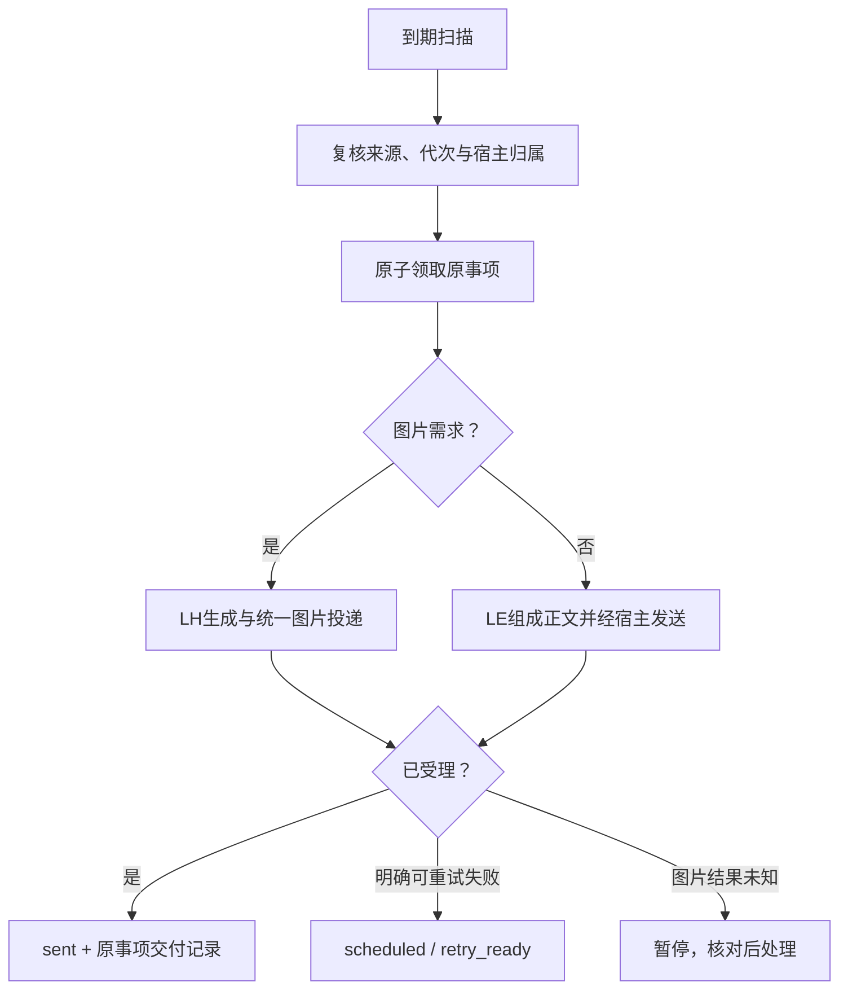

# 承诺的识别、兑现与取消

适用LE 0.7.1 / LH 2.9.6。入口：“主动行为 → 承诺”和“设置 → 承诺兑现”。
`promise_enabled`控制建立和执行；关闭保留已有任务。页面可展开任务并点击
“取消后续处理”，聊天取消标记沿用同一事务入口。
具体默认值、范围和例子见[配置参考](config-reference.md)。

## 建立任务

模型在正文中使用 `<!--promise:2分钟:把窗边的照片发你-->`。
装饰阶段删除标记；只有正文全部发送组件成功后才落库，单独的after-sent钩子不算送达。
普通承诺使用“马上、一会儿、待会、今晚、明天”等档，显式秒/分钟/小时按指定延后执行。
“马上”随机120–300秒，“一会儿”900–1800秒，“待会”2400–4200秒。
模型提供档位，落点由本地时钟计算。

用户发起的固定提醒、循环任务由宿主future_task处理；Bot自己答应的事项由LE处理。
两者按会话、发起人、内容和时间仲裁，宿主已有归属时标记delegated。
宿主查归属、任务注册和LH领取共用同一把所有权锁。

同会话归一化描述去重；更早时间可提前已有任务，较晚同内容视为重复。
已发送的10分钟窗口只阻挡重复提交。`promise_max_active`范围1–10；
降低上限保留已有任务，不批量删除。等待和未知图片仍占一个名额，复用原ID不额外占名额；
模型提示最多展示前三项并说明总数，控制台展示全部项目。
`promise_max_depth`和`promise_advance_limit`目前保留配置，但创建/提前路径没有读取，
不能将其描述为已执行的限制。

## 到期与状态

到期独立发送，不等待用户下一条消息。内存来源缺失时可从已登记会话恢复路由；
会话彻底不存在则取消。普通文本明确失败按300秒延期、有界重试。
`promise_retry_limit`为0–10次，默认5；与图片改词共用预算，0关闭自动重试。
等待和未知任务按`promise_wait_timeout_hours`（1–168小时，默认24）到期收尾，
升级、刷新和追问不延长等待；到期保留请求证据并释放名额。详见[重试与收尾](promise-retry.md)。
承诺不占主动闲聊每日次数；实际生图仍计LH每日图片额度。
动作模式由耦合就绪且许可共同决定，关闭动作模式仍可使用普通文本兑现。

| 状态 | 当前含义 |
| --- | --- |
| scheduled | 到期扫描的待执行任务 |
| running | 已领取，复核生成/投递阶段 |
| awaiting | 升级前或并入回复的保留状态 |
| waiting | 等待调整、服务恢复或人工核对 |
| unknown | 图片生成/发送副作用不明，不自动重试 |
| delegated | 宿主拥有任务，LE不执行 |
| sent / cancelled / failed | 已受理、已取消、终态失败 |

生成阶段检查点为retry_ready/generating/generated/sending/sent/held/unknown。
已生成文件只重试投递；generating/sending/unknown不再次生图。
重启不恢复未知图片副作用；准备好的改词候选可继续使用。
图片确定拒绝、有限改词和学习见[提示词调整](image-prompt-retry.md)。

## 原图片事项与回执

主模型可把明确的`promise_id`交给LH生图工具。收费前领取原事项，
`request_id`、会话、账号、人格修订和代次必须一致；未领取不调用上游。
成功只完成该原事项，无ID的新图不会完成其他旧任务。
即时失败仍保留原ID；映射许可通过的明确拒绝300秒后回到原执行链。
成功正文保存至promise_traces，缓存按`promise_trace_ttl_hours`（1–168小时）；
近期交付图片最多5条、7天用于后续追问，不表示模型做过视觉检查。

## 取消与调整

正文支持`<!--promise-cancel:编号或关键词-->`，亦容忍合理的括号编号与空格。
多条任务必须唯一定位；“全部取消”先核对整批状态再原子取消，不留下半批。
scheduled/awaiting/waiting/unknown可以取消后续处理；running受保护。
取消未知任务不确认上游已撤回，不再次生成或投递。
waiting的确定内容失败可用具体新画面恢复同一ID，清除旧候选并重置调整预算；
纯“再试一次”、确认语或取消语不算画面调整。多图需ID、编号或原画面明确选择。

## 页面与排查

承诺区域显示总数、全部事项、目标ID、创建/原定/当前时间与原因。
列表每60秒自动更新，保持已展开详情和可保留的焦点。
看“排队中”先核对due_at、来源和last_error；未知状态先查请求/投递回执，
不能拿cron完成摘要当平台送达。接口见[API](api.md)，测试见[检查分层](delivery-notes.md)。
