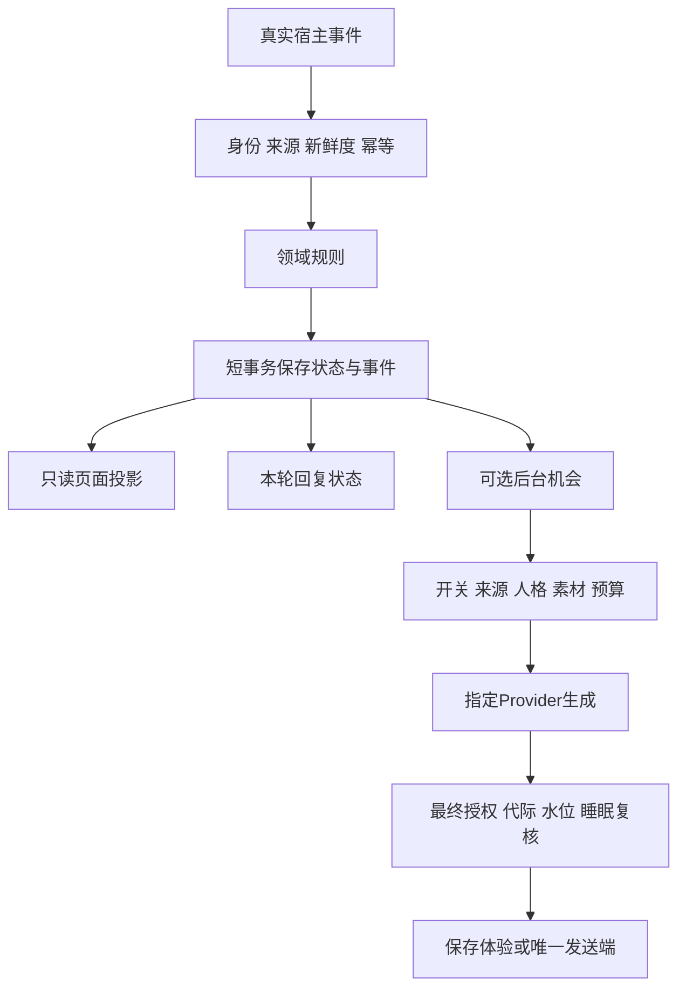

# 技术说明

适用0.4.3。读者：插件开发者、集成和运维维护者。维护：AKIhunter。
2026-11-19依据当前源码与离线验收核对；接口、状态机、配置、存储或路由变化时同步。
本页是当前技术总览；[使用手册](user-guide.md)负责操作，[原理示例](principles-examples.md)负责算例。

## 模块与数据流

| 层 | 入口 | 职责 |
| --- | --- | --- |
| 宿主 | `main.py`、`runtime/application.py` | 消息/回复钩子、生命周期、配置装配、后台调度 |
| 契约 | `api.py`、`contracts.py` | API v1、完整Context、事件、状态和回执 |
| 领域 | `domain/` | 情绪、关系、作息、主动机会的纯计算，不访问SQL或网络 |
| 投影 | `runtime/projector.py`、`runtime/state_scope.py` | 事件应用、状态所有者、人格共享与来源隔离 |
| 持久层 | `storage/` | SQLite事务、CAS、清除代际、意图、归档与配额 |
| 服务 | `services/`、`runtime/night.py`、`runtime/models.py` | 素材、体验、行为、睡眠与模型调用守卫 |
| 适配 | `adapters/` | 原生人格、模型、公开记忆接口与唯一发送端 |
| 页面 | `page_api/`、`runtime/console.py`、`pages/livingemotion/` | 鉴权、配置回执、只读DTO、自动刷新与草稿保护 |

SQLite I/O在线程中执行，事务内不等待模型/网络。状态共享仅共享允许的数值；
私人正文始终绑定原会话。完整Context限制实例、Bot、人格、适配器、平台、场景与账号，
同名人格或同账号不能代替授权。清除代际阻止旧任务回写。

## 情绪与关系

规则运行四维：愉悦[-1,1]、唤醒/压力/社交需求[0,1]。
页面愉悦映射为 `(pleasure+1)/2`；底气是第五展示轴，仅异步模型写入，
不参与本地四维规则或LivingHello状态注入。情绪增量经过置信度、强度、
单次/同类限制和开心300秒正负预算，时间恢复另算。
详细公式见[五维情绪](emotion-five-dimension.md)、[开心窗口](joy-window.md)。

关系原始分0–1000，页面0–100。明确指向Bot的当前言行才自动计分，
非零变化0.5–1显示分，正负日预算分别2.4分；普通互动最高99。
100分与冻结由管理员操作，后端核对relationship_edit_enabled。
新个人生图由[婉拒契约](relationship-image-refusal.md)判断一次，既有图片承诺不重抽。

## 睡眠总开关与纯读取

`allow_sleep`是唯一运行时许可。关闭时 `domain/night.py`把夜间状态规范为清醒/100%，
清除睡眠周期、唤醒窗口、时间余数和手动抑制；回复与消息投影不能再扣精力。
`storage/night.py`在实例范围规范全部存量记录；启动和配置替换都调用，
覆盖没有近期活动的状态。重新开启先推进计时起点，不补扣关闭期间。

自动、手动、睡前收尾和自动梦境均检查实际许可；修改作息参数不会隐式授权。
`Console`只读上下文和 `Runtime.night_guard`只投影当前状态，不写库或抽赖床，
页面刷新不能推进随机周期。实时调度入口负责周期创建和持久化。
v2精力按0.1点整数保存，余数保留到微秒；时钟回拨不倒退计时。
完整阈值和在途票据见[睡眠规则](sleep-energy-rules.md)。

## 日记与梦境可靠性

自动日记/梦境与管理员手动入口分别检查权限：手动日记不受自动日记开关限制；
手动梦境仍需dream_enabled，但不要求实时睡眠。自动梦境要求同周期仍睡眠、
未到起床、已睡满60分钟，不要求恰好REM；旧原因码名可保留兼容。

`services/experience.py`使用任务亲自读到的素材快照；普通情绪版本变化不使它失效，
但身份撤销、正文来源权限、清除代际和取消仍须最终复核。正文最多2000字符。
`runtime/models.py`给日记和梦境独立8192输出Token预算，返回值不再以中文UTF-8字节
冒充输出Token；上游限制仍可更小。输入预算名model_input_tokens为历史兼容，
实际按完整请求UTF-8字节上界估计，不能作为账单usage。

## 后台模型与发送

专用用途Provider优先于通用Provider，通用空值才尝试当前已保存真实会话Provider。
请求派发前候选不可用可使用备用；未知/可能已计费结果不自动再次派发。
本插件不存新API Key，使用宿主Provider；router固定上游编号要核对实际映射。

主动机会先持久消耗，再评估和执行；睡眠、模式、静音、白名单、时段、额度、
未回应、素材和消息水位都是实际闸门。生成后再次核对来源、身份与代际，
通过唯一发送端提交。承诺与宿主future_task按真实事项保守仲裁，不重复登记。
`accepted`仅本地接受，`sent`仅宿主受理，均不证明平台最终送达。
明确未发送的拒绝可按有限策略重试；未知发送不盲重发。
见[主动聊天](proactive-life.md)、[承诺](promise.md)、[延迟动作](promise-actions-20261116.md)。

## 接口与鉴权

可信插件每次发现当前激活的 `plugin.api`，先检查版本/能力，再解析真实来源和调用。
不要缓存重载前实例或直接读取他人的配置、私有数据库。
进程内v1方法、Context量纲与管理端点见[API](api.md)。
范围/状态、记忆、回复契约分别见
[状态](internal-state-contract.md)、[记忆](internal-memory-contract.md)、
[回复](internal-reply-contract.md)、[管理](internal-console-contract.md)。

页面经宿主bridge访问相对console端点。私有读写严格校验Dashboard管理员Bearer，
资源token不能授权私人状态或写配置。页面context_id是后端发布的不透明账号级ID，
不能当作scope_key或路由。配置保存带expected_revision和reason，CAS冲突返回409，
动作仍检查confirmed及最终业务许可。旧api.md中的早期端点数量/枚举只是历史参考。

## 配置与升级

公开schema是平铺133字段：32开关、101参数；Config另有8个旧兼容字段。
`Config.from_mapping`保留显式值，缺少新字段按兼容规则识别，不盲用新安装默认覆盖旧配置。
显式allow_sleep优先；缺少才读取旧作息许可，保存后不会被旧键再次覆盖。
allow_sleep=true且旧schedule=false的组合，升级后自动计划也受allow_sleep许可。
旧字段不再提供隐藏权限，新页面拒绝提交已撤下键。

部署前备份源码/原配置和SQLite一致快照，逐文件SHA256核对并保留无关线上漂移。
代码回滚仅恢复本轮范围文件，保留新业务数据；数据库恢复需独立判断，
不能用历史快照直接覆盖仍在增长的库。详细通用步骤见[独立运行](local-runtime.md)。

## 验证层次

0.4.3本地便携Python2229项全过，对比同环境0.4.2基线2193项全过；
UI单元16项、1280/390×浅/深四布局通过。既有23条JUnit属性格式警告保留。
自动体验修复、状态快照和只读读取均有离线回归。完整矩阵采用虚拟时间、
临时SQLite、假Provider与假发送，不是生产模型效果或平台投递验证。

普通 `python -m pytest -q`是便携层。真实宿主、ASGI、Provider payload另有显式入口，
见[交付分层](delivery-notes.md)与[兼容矩阵](compatibility.md)。
文档/版本/字段默认值检查在CI运行，新文档覆盖全部开关/参数并校验本地链接。
历史报告的测试数只用于当时范围，不能替代当前代码检查。
