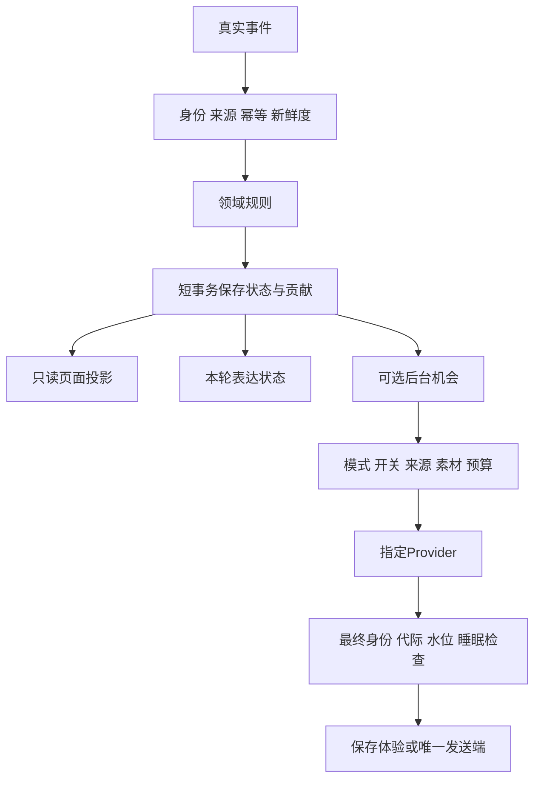
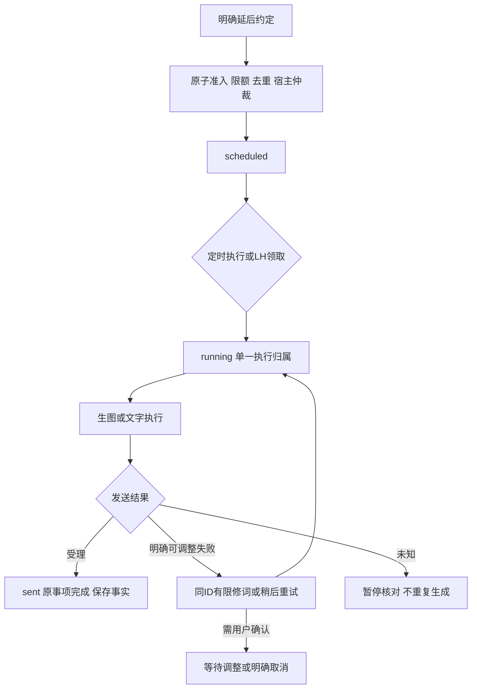

# 技术说明与判断流程

适用0.10.0，2026-11-26依据源码核对。维护者在接口、状态、配置或存储变化时更新。
操作见[使用手册](user-guide.md)，字段见[配置参考](config-reference.md)。

## 模块与状态

| 入口 | 职责 |
| --- | --- |
| main.py / runtime/application.py | 宿主钩子、配置装配、后台调度、生命周期 |
| api.py / contracts.py | 版本契约、完整Context、事件与回执 |
| domain/ | 情绪、关系、作息和主动机会的纯计算 |
| runtime/projector.py / storage/ | 事件投影、SQLite事务、状态所有者与代际 |
| services/ / adapters/ | 素材、体验、模型、记忆与发送适配 |
| page_api/ / runtime/console.py / pages/ | 管理鉴权、DTO、保存回执、自动刷新 |

完整Context包含实例、Bot、人格及修订、适配器、平台、场景、账号与来源路由。
数值可以按同人格共享，私人正文保持原来源。SQLite I/O在线程执行，
事务内不等待网络；CAS和清除代际限制迟到回写。页签读取不等于授权发送。

## 情绪和关系

愉悦[-1,1]、唤醒/压力/社交需求[0,1]参与规则；掌控感调节负面情绪和聊天表达。
掌控感沿用联合模型分析，以0.2平滑更新，置信度至少0.75；按60分钟半衰期回到0.5。
中性与旧公式一致，不改变四维增量、关系、开心预算和主动发送评分；
普通回复、主动聊天、模拟共用表达策略。新梦境基调也使用调节后的六项，
已有梦境不重算；详细边界见[掌控感](control-integration.md)。
增量经过置信度、强度、单次/同类限制和300秒开心正负预算；
时间衰减与天气只改变回落目标。天气不使用LLM。
关系原始0–1000，页面0–100；普通互动最高99，100分由管理员设置。
当前明确指向Bot的言行才计入关系，来源和日预算独立检查。

委屈、受伤、害羞由 `domain/context_emotion.py` 单独计算，不改变四维增量。
默认关闭，仅 active 采集。会话维度（默认，`context_emotions_dimension=conversation`）保存到
relationship 的 `_account_affect.context_emotions`；用户维度（`user`）保存到 `owner_states`
（`owner_key` 为「实例 + 人格 + 平台 + QQ」的人级键，`kind=context_emotion`），同一 QQ 的私聊与各群共用一份。
两种维度都不改表，已有库无此字段按未采集处理，切换维度不迁移数据。账号、人格修订、平台与清除代次隔离；
用户维度下清除任一会话会同时清除该 QQ 的人级记录。
跨重启恢复需稳定来源与人格内容指纹一致；同进程人格修订变化不复用旧值。
委屈/受伤半衰期1800秒、最长7200秒，害羞半衰期480秒、最长2400秒。
已采集 DTO 返回完整衰减值，表达仅取强度≥0.2的前两项，禁止伪造帮助证明或越过关系边界。
模型开启时，context_appraisals按最近8条同对象对话、当前原文与已有情绪判断，
结构、主体、原文证据和引用归属仍由代码校验，空数组不回退本地词汇规则。
联合分析先复用；仅实际调用前的quota_cooldown拒绝可补专用对象分析，
共用每日额度，输入/输出上限分别为min(8192/512,全局预算)，不更新四维或掌控感。
回复等待同事件任务最多1秒；超时只放行回复，任务不取消，结果后台写回。
同一会话来了新消息时，current 检查仍拒绝迟到回写。
写入继续核对Provider、记忆许可、owner、generation、版本和新消息水位，
失败或未知结果不重复收费。关闭模型时沿用本地规则。详见[情绪谱](ta-emotion-spectrum.md)。

## 睡眠许可

allow_sleep是唯一运行时许可。关闭时领域规范为清醒/100%，清除周期、
唤醒窗口、计时余数与手动抑制。消息投影和回复提交均不能扣精力。
启动和配置替换在实例范围规范包括闲置范围的保存状态。
再次开启推进计时起点，不补扣关闭期间。保存作息参数不隐式授权。

v2精力按0.1点整数保存，时钟回拨不倒退计时。调度负责创建周期并保存赖床，
页面只投影现有状态。回复票据含代际、周期和唤醒信息，生成前后复核；
重复或分段提交不重复收费精力。详见[睡眠规则](sleep-energy-rules.md)。

## 主动行为与体验

随机机会先保存，再检查许可、时段、安静时间、名单、额度、未回应与素材。
预留后的失败也计预算，不能靠重试恢复额度。宿主定时问候只读检测，
仅同会话在宿主保存时间前后各15分钟让行；其余时段保留随机机会。
UTC时间、缺失目标与过期机会边界见[定时问候让行](native-proactive-yield.md)。
手动测试、手动生成与自动准入分开，测试模型并非零消费。
体验任务使用亲自读取的素材快照，普通情绪版本变化不取消素材，
身份撤销、清除代际和来源许可仍阻止迟到保存。
输入预算兼容名model_input_tokens实际按UTF-8字节上界；日记/梦境独立8192输出Token，
正文2000字符，不以中文UTF-8字节冒充输出Token。

## 承诺与图片交接

挂起上限事务内判断，拒绝新增但不删除已有条目。取消按当前真实来源选全组，
执行中和未知项阻止整组取消。当前advance上限固定3次，兼容字段不改变这一值。
到期由PromiseService独立执行，宿主同事项接管则不重复。

livingemotion.image-result.v1在收费前把同promise_id领取为LH外部执行，
核对来源、运行代际、图片事项及状态。定时扫描跳过外部所有权；
结果按同request_id结算，sent不被重复/晚到失败降级。
明确限流或授权的提示词失败移回同ID队列并清除外部归属，未知结果留待核对。
成功回执按来源读给后续模型，说明仅是发送事实，不声称视觉检查。
LH没有绑定ID的新图不会完成其他旧任务。详细映射见[契约](image-prompt-retry.md)。

## 管理、升级与验证

页面bridge使用宿主管理员鉴权；不透明context_id不是路由或scope_key。
TA选择保留具体会话，关系页只共用人格，独立保存平台、查询与页码。
日列表按配置时区00:00取精确分数快照，复用runtime_meta，每人格仅一份；
首次或跨日恢复按实际时间补算。后台与读取共用同一事务入口，
清除代次不匹配的来源不再显示；实时3D与编辑继续使用当前CAS版本。
模型选项标签使用可读名称，实际保存仍是Provider ID；自动刷新保留表单节点。
模型诊断比对只忽略持久目录去掉的route，不改变业务授权和发送校验。
保存带expected_revision，失败/冲突保留草稿。接口清单以[API参考](api.md)为准。
可信集成每次发现当前激活实例，检查能力，走公开接口；不读另一插件私有配置或库。

旧字段仅供兼容，显式allow_sleep优先；宿主构造前可能清理旧键，
升级前备份并明确保存缺失的睡眠许可。SQLite v9仅增加可空历史control/control_at，
旧历史保留采集缺口，以中性值计算并返回control_basis，不用当前状态回填。
新增图片回执表自动创建，
旧配额算法和成功次数不重置。回滚范围源码时保留增长中的业务库，不能用旧快照覆盖。

便携层用虚拟时间、临时SQLite、假Provider与假发送；真实宿主/ASGI/双插件是显式层。
单元、浏览器与双插件门面通过不能证明真实模型语义或平台最终送达。
运行入口见[开发分层](delivery-notes.md)；历史测试结果统一见[更新日志](../CHANGELOG.md)。
